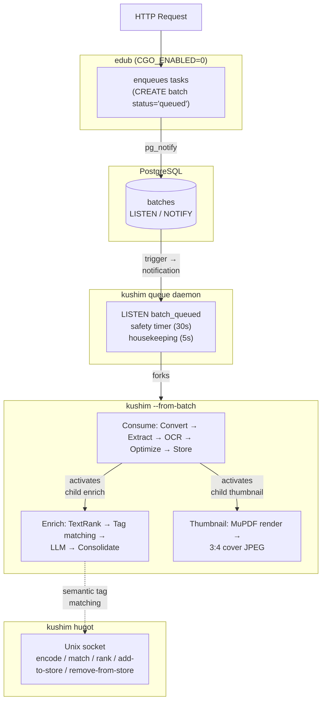

# Architecture & Design

## Core Design Principles

- **Headless First**: API-driven with CLI interface; web UI as optional layer
- **Tool Agnostic**: Adapter pattern; OCR, text extraction, PDF optimization, content analysis,
  and text reduction are all switchable between built‑in adapters and external tools/providers.
  Semantic tag matching uses the same adapter interface with a single concrete
  implementation (Hugot) — pluggable tag matcher adapters are on the roadmap.
- **PostgreSQL Target**: SQL and generated Go code target PostgreSQL. SQL files use `$1, $2` placeholders and PostgreSQL DDL (`GENERATED ALWAYS AS IDENTITY`, `JSONB`, `TIMESTAMPTZ`). sqlc engine is `postgresql`. The `kushim setup` wizard, `Bootstrap`, and `NewTestDB` all use `NewPostgresDB`.
- **Fallback Processing**: Text extraction → OCR → text extraction pattern
- **Date-based Organization**: Temporal storage structure for scalability
- **Transaction Safety**: Coordinated database and file operations with rollback
- **Process Isolation**: The Hugot embedding model runs as a **separate process** (`kushim hugot`), communicating over a Unix domain socket. The API server (`edub`) is pure Go (`CGO_ENABLED=0`) — it enqueues tasks and the `kushim queue` daemon forks workers for document processing; `edub` communicates with the matcher via RPC.
- **Two Binaries**: **kushim** (CLI document processing + matcher server) and **edub** (REST API server). Static C dependencies (Tesseract, Leptonica, MuPDF) linked only into **kushim**; **edub** is compiled with `CGO_ENABLED=0`.

See [Roadmap](roadmap.md) for the implementation status and upcoming priorities.

---

## Process Architecture

The system runs four cooperating processes. All three long-running services
(`kushim hugot`, `kushim queue`, `edub`) are grouped under an
`edub-kushim.target` systemd target via `PartOf=`, allowing a single
`systemctl enable --now edub-kushim.target` to manage all of them. The hugot
service uses `Type=notify` + `NotifyAccess=main` and sends `READY=1` via
sd_notify after the model is loaded, tag cache is built, and the Unix socket
is listening, so `After=` dependents actually gate on readiness.

### 1. Queue Daemon (`kushim queue`)

A long-lived daemon that manages batch processing and inbox polling. Batch consumption is driven by Postgres `LISTEN`/`NOTIFY` (the `batch_queued` and `lock_released` channels via a dedicated pgxpool connection), with a 30-second safety timer as fallback. Housekeeping tasks (the declarative schedule loop, stale-task reclamation) run on a separate 5-second ticker; configuration arrives through the shared content-hashed `config.Watcher` and is applied on the daemon loop. The concurrent loops are: (a) **notification-driven consumption** — when any batch transitions to `status='queued'`, a Postgres trigger (`notify_batch_queued`) sends a `pg_notify` to the `batch_queued` channel; a dedicated `LISTEN` goroutine forwards the signal over a buffered channel, the daemon picks the batch up immediately (milliseconds): the dispatcher claims it — batch status, lease and resource holds in one guarded transaction — and forks the batch's owning task CLI (`kushim --executor consume|enrich|thumbnails|backup|mirror|tagreconcile|tagmeasure|tagidentity|tagaudit|tagmaintenance|migrate --from-batch <id> --exec-token <token>`; a mixed ingest batch resolves to `consume` by fixed precedence, and a batch made only of tag types chained by waiting successors — the maintenance routine — resolves to `tagmaintenance`), which adopts the claim's lease. (b) **safety timer** — a 30-second fallback poll in case a notification is dropped (connection blip, reconnection), guaranteeing no batch is stuck longer than 30s. (c) **stale batch reclamation** — reclaims a bounded page — oldest heartbeat first, `ListStaleBatchOwners`'s `LIMIT`, the remainder following on the next tick — of stale batch owners (>15s heartbeat with active tasks) by releasing the listed ownership row — scoped by the row its snapshot described (`batch_id`, `owner_id`, `pid`, still stale — `ReleaseStaleBatchOwner`), so an owner that adopted or heartbeated since keeps its lease and the iteration is skipped on zero rows — and signalling `SIGTERM` to the released owner's PID only when the release landed. It then quarantines tasks at or above `consumer.reclaim.max_retries` (default 3) to `failed`, quarantines the returned task identities' inbox files to `storage/errors/` (`QuarantineFailedFiles`, classified by task identity instead of error text), resets remaining processing→pending with an incremented attempt counter — the reset restore re-arming a discarded successor whose parent chain turns live again — then checks `HasPendingWork`. If the batch has remaining pending/processing/waiting tasks it is re-queued; otherwise the guarded settle records `completed` or `failed`. Any recovery step failing after the release runs the same guarded requeue, so a released batch can never be left `processing` with no lease (gated by `consumer.reclaim.enabled`, default `true`). (d) **stale task reclamation** — an age-based sweep that resets individual `processing` tasks back to `pending` (or `failed` if at max retries) when their `started_at` timestamp exceeds `consumer.reclaim.stale_task_after` (default 600s; the cutoff is evaluated by the database clock), then moves the quarantined consume tasks' inbox files immediately. This is the safety net for tasks the runner could not complete: handler panics are failed and settled by the runner's per-task recover, so the sweep covers hard crashes (kill -9, OOM) where no Go-level recover can run. Lock-holding tasks (backup, mirror, the four tag passes and the maintenance routine that chains them, thumbbackfill, and the two migrations) are swept only when no resource lock belongs fresh to their batch — the exemption matches a lock row by batch id inside the 30-minute window, refreshed by the run's 5-minute lock heartbeat, shielding a live holder from both reset and lock release, while a crashed holder is recovered exactly once. The sweep runs at most once per `max(60s, stale_task_after/10)` to avoid unnecessary write-lock pressure. (e) **inbox polling** — the declarative scheduler's unnamed entry scans the consumption directory on a plain interval (`consumer.polling.interval`, floored at one minute, measured from the last dispatch), deduplicates by MD5, enqueues a `queued` batch, and lets the consumer loop pick it up; the scan dispatches on its own goroutine so slow inbox I/O never stalls the daemon's other loops, and overlap is the consume dedup keys' responsibility. When `enricher.tag_measure.after_enrichment_batch` is set, every ingest and reenrich enqueue declares a measurement follow-up — a JSON declaration on the batch row that the batch's settle consumes, creating a `trigger`-origin `tagmeasure` batch inside the terminal write (deduplicated to one live run by the pass's constant key) so the pass observes production as it lands. When `backup.enabled` is `true`, the declarative scheduler (`internal/ops/queue/scheduler.go`) contributes one schedule per configured backup mode (names `backup:<mode>`); when `mirror.enabled` is `true`, the mirror schedule joins it carrying the rsync precondition (`backup.MirrorPrecondition`, also enforced for `kushim batch create mirror`); tagreconcile, tagmeasure, tagidentity and tagaudit schedules follow their own gates (`enricher.tag_reconcile.enabled`, `enricher.tag_measure.enabled`, a fixed daily 03:30 pass under `enricher.tag_adjudicator.enabled`, `enricher.tag_audit.enabled`) and the pass's fixed dedup key, so an active run blocks the next trigger beyond the schedule-name active check (a tagmeasure run over a store unchanged since the last completed run under the current rule set reports zero work and writes nothing); `enricher.tag_maintenance` contributes the maintenance routine — one batch chaining reconcile, identity, audit and measure as waiting successors — whose enabled flag contributes its own `tagmaintenance` schedule while idling the reconcile, measure and audit schedules (the daily identity pass stays: the routine's identity step is a catch-up, not the only path to identity); tagidentity batches also come from `POST /api/v1/tags/identity/reevaluate`, a manual trigger, and tagaudit batches from `POST /api/v1/tags/audit/reevaluate`. Every entry's producer builds an ordinary task set — any task types, chained waiting children included, exactly like the ingest producers — and the enqueue validates it; the entries themselves are type-blind. Every one of those batches is an ordinary queued batch: the dispatcher claims it — the claim takes the batch's holds under the execution token — and forks the type's own CLI child (`kushim --executor backup|mirror|tagreconcile|tagmeasure|tagidentity|tagaudit|tagmaintenance --from-batch <id> --exec-token <token>`), which adopts the claim's lease, keeps the hold fresh (heartbeat + drain of the declared waiters) for the whole run and stores the pass's report as the task result; the enabled flags gate only automatic enqueueing, so a manual `kushim batch create tagreconcile|tagmeasure|tagidentity|tagaudit|tagmaintenance` batch is always claimed). Batches carrying `thumbbackfill` tasks hold the `storage` lock for the whole run: the dispatcher claims them — the claim transaction verifies the `maintenance` hold is free and takes the `storage` lock — and forks `kushim --executor thumbnails --from-batch` children, which adopt the claim's lease, keep the hold fresh (heartbeat + drain of in-flight thumbnail tasks) and run one worker for the type at its declared concurrency. Only the polling entry's producer still skips its scan while the `maintenance` lock is held (a backup, mirror, tag reconciliation, tag measurement, tag identity, coverage audit, the maintenance routine, migrate-db, or migrate-storage running), preventing concurrent data access; the other schedules never check locks — a batch enqueued while a lock is held simply queues for the dispatcher — and a `storage`-only holder does not pause polling. Configuration reaches the daemon through the shared content-hashed `config.Watcher` (a change commits only on two consecutive identical polls; invalid YAML keeps retrying while unparseable), and the daemon loop applies each staged tree — swapping the container configuration — so `consumer.polling` changes take effect within a poll interval without restart. If the applied tree changes the database connection settings (after a `migrate-db` task), the daemon probes the new connection (open + `InitializeSchema`), drains the scheduler's background occurrences — the inbox scan and the scheduled thumbnail backfill — between the new pool opening and the old one closing, then invalidates the cached DB handle, reconnects all services, and restarts the `LISTEN`/`NOTIFY` session; a failed reconnect keeps the previous configuration tree pending (running occurrences stay untouched on the healthy old pool) and retries the swap on the housekeeping tick. Uses a PID file for single-instance enforcement and logs to `<config_dir>/logs/queue.log`. Can be daemonized via `--bg`.

### 2. Matcher Server (`kushim hugot`)

A standalone HTTP server over a Unix domain socket (`kushim-hugot.sock` in the config directory). Hosts the Hugot embedding model, manages the tag embedding store, and exposes RPC endpoints:

| Endpoint                         | Method | Purpose                      |
| -------------------------------- | ------ | ---------------------------- |
| `POST /rpc/v1/encode`            | POST   | Encode text to embeddings    |
| `POST /rpc/v1/match`             | POST   | Match text against tags      |
| `POST /rpc/v1/rank`              | POST   | Rank tag names against the store, return candidates with scores |
| `POST /rpc/v1/add-to-store`      | POST   | Add names to embedding store |
| `POST /rpc/v1/remove-from-store` | POST   | Remove names from store      |
| `GET /health`                    | GET    | Health check                 |

This process requires CGo (Tesseract/Hugot libraries) and should be started before the API server.

### 3. API Server (`edub`)

Pure Go binary (`CGO_ENABLED=0`) that handles HTTP requests. It:

- Enqueues consume/enrich/thumbnail tasks when `POST /api/v1/consume` is called, creating batches with `status='queued'` (plus tag-identity/tag-audit runs from the review surfaces and `migrate-db`/`migrate-storage` batches from the config handler)
- The `kushim queue` daemon picks up queued batches and forks the batch's owning task CLI (`kushim --executor consume --from-batch <id>` for ingest batches, `kushim --executor migrate --from-batch` for migrations) for processing; `edub` never claims a batch
- Watches `config.yaml` (5s poll): when the database connection settings changed on disk — after a `migrate-db` task persists them — it reconnects the whole server (services, task catalog/enqueuer, route handlers) to the new database; on connect failure it keeps the previous configuration. Storage directory changes (persisted by a `migrate-storage` task) are picked up the same way — the inbox scan and storage layout then use the new paths. Asset downloads (tessdata, Hugot model) are direct config updates started on the config save, not tasks.
- Probes the matcher socket on startup (logs a warning if unreachable); tag CRUD is not blocked — embedding-store sync errors are logged and swallowed
- Does not manage inbox polling — the queue daemon (`kushim queue`) scans through its scheduler's polling entry

### 4. CLI / Worker (`kushim`)

The CGo binary that performs actual document processing:

- `kushim consume` — scans inbox, enqueues tasks, direct-fallback if queue empty
- `kushim <task> --from-batch <id> --exec-token <token>` — executes one claimed batch (the dispatcher and `kushim batch run` are the launchers that claim it and pass the execution token; the token is required — there is no self-claim path)
- `kushim queue` — starts the batch queue daemon for background consumption and inbox polling
- `kushim hugot` — starts the matcher RPC server
- `kushim setup` — setup wizard
- `kushim backup` — create a backup of database, config, and storage files (`--mode full|database|documents`)
- `kushim mirror` — mirror the storage tree to a local or remote destination with `rsync --delete` (waits for the backup lock and task drain; writes a `.edub-mirror.json` diagnostics file; requires `rsync` on PATH)
- `kushim restore` — restore from a backup archive (mode-aware: `documents` archives skip the SQL dump, `database` archives skip the storage swap)

### Communication Flow



The matcher is optional — if it's not running, `edub` logs a warning and the tag embedding cache is not updated (errors are logged and swallowed), but tag CRUD itself still succeeds. The `kushim` CLI (used for document processing) can start its own matcher when run directly (via the consume command which has direct Hugot access), or communicate with the external matcher via the same RPC interface.

---

## Processing Pipeline

### 1. File Discovery

Scans `consumption_dir` for supported extensions, detects MIME type, computes MD5 and
SHA512 checksums in a single pass.

### 2. Duplicate Detection

MD5 checksum lookup → SHA512 verification. Skips processing on exact match.

### 3. Text Extraction

Two‑stage strategy (configurable via adapter pattern):

**Primary** (default: `mupdf`): Extracts embedded text from PDF via MuPDF's
structured text device (page‑by‑page streaming, no Go heap pressure). If text
is found above a minimum density ratio (`minTextDensityRatio = 0.001`), the
PDF is optimized (MuPDF or Ghostscript) and stored. If optimization fails,
the original file is used as the processed copy — ingestion continues.

**Fallback** (default: `gosseract`): OCRs pages via Tesseract and produces a
searchable PDF. Text is re-extracted from the OCR'd PDF. For image‑only PDF
pages, MuPDF renders at 200 DPI before OCR; for standalone image files (PNG,
JPEG, TIFF), the image is decoded directly with Go's standard library, alpha‑
composited on white, and sent to the same OCR pipeline.

The external‑tool adapters (`pdftotext` for text extraction, `ocrmypdf` for OCR,
Ghostscript for PDF optimization) are available as alternatives. Configure via
`consumer.textextractor`, `consumer.ocr`, and `consumer.pdfoptimizer`.
Thumbnails use the `consumer.thumbnail` section (`engine: 'mupdf'`, the only
implemented engine) with `dpi`, `max_width`, `quality`, `timeout`, and
`workers`; disabling `consumer.thumbnail.enabled` skips thumbnail-task
creation entirely at batch-enqueue time.

When active, the gosseract adapter processes each page at 200 DPI — source
material comes from a MuPDF render (image‑only PDF pages) or from a direct
Go `image.Decode` (standalone PNG, JPEG, TIFF) — encodes to PNG, OCRs with
Tesseract, and builds a searchable PDF with `go‑pdf/fpdf` using **text
rendering mode 3** (`3 Tr`) for invisible‑but‑selectable text.

### 4. Database Integration

Document record created via `CreateDocument` with a generated `document_id` UUID,
auto-increment ID obtained from `RETURNING id`, date‑based storage paths
generated, paths updated via `UpdateDocumentPaths`. The transaction is
DB‑only (fast writes), bounded by a 30‑second context timeout.

The UUID serves as the stable external identifier for the API, while the
auto-increment ID is used for internal storage paths.

### 5. File Movement (pre‑transaction)

File I/O runs **before** the DB transaction to avoid timeouts on slow storage.
If file I/O fails, any partially‑written storage files are cleaned up and the
original is quarantined — no DB row is created. Three‑way branch:

- **OCR case**: Move OCR temp file → processed storage, copy original → original storage.
- **Optimized text case**: Copy original → original storage, move optimized file → processed storage.
- **Converted case** (DOCX/ODT → PDF): Copy original → original storage, move converted PDF → processed storage.
- **Unoptimized text case** (optimization failed or skipped): Copy original → both processed and original storage.

### 6. Transaction and Cleanup

After files are in place, a short transaction creates the document record and
updates storage paths. On transaction failure (statement error or commit
failure), both storage files are removed and the original is quarantined. The
deferred rollback also handles temporary file cleanup (OCR / optimized PDF
temp files). On success, the inbox original is removed.

### 7. FTS Indexing

The `document` table has a `text_search_vector` column of type `tsvector`,
`GENERATED ALWAYS AS (to_tsvector('simple', coalesce(title, '') || ' ' || coalesce(text_content, ''))) STORED`,
backed by a GIN index (`idx_document_tsv`). Queries use `plainto_tsquery('simple', ...)`
for tokenization and `@@` for matching. Rank and snippet are produced by `ts_rank`
and `ts_headline`.

### 8. Async Enrichment (Post-Consume)

Ingest creates the enrich task at batch-enqueue time, immediately, in
`waiting` state, linked through the `task.parent_task_id` column — the
successor names its parent; the parent names nothing. The task system owns
the successors' lifecycle: on the consume task's success, the completion
transaction activates the waiting successors (`Store.CompleteTask`): each is
flipped to `pending` under its own savepoint with the dedup key derived
through the type definition (the same key the enqueue applies), after the
declared `inherit` fields are copied out of the parent's result into the
successor's payload. A conflicting activation — live work already under that
key — discards the duplicate successor, with the waiting branch below it,
in the same transaction instead of failing the parent, whose work is done,
and a successor the plan cannot complete (missing inherited field, missing
definition, empty key) is discarded with the reason rather than activated
under an unusable payload. If the consume task fails, its whole waiting
branch is discarded atomically with the failed write (`Store.FailTask`).
**On retry** — a retried consume rides the one batch resume operation
(`kushim batch restart` or `POST /api/v1/batches/{id}/resume?retry_failed=true`): the failed consume goes back to `pending` and
its discarded successors are restored to `waiting` in the same transaction, so
the requeue never exposes a task whose successors still look dead; a later
successful run re-activates them.

Each consume also spawns a parallel `thumbnail` successor (created at
batch-enqueue time when `consumer.thumbnail.enabled`, linked through
`parent_task_id`). It follows the same activation
contract: activated to `pending` after a successful consume (its payload
carries `document_id` from enqueue and inherits `storage_path` from the
consume result), discarded with the consume failure (waiting branch
cascaded), and restored to `waiting` on retry; the recovery sweeps cover
every linked type (a `waiting` successor of a dead parent is discarded with
the parent's error text, recursively down the branch — §8/§10 of the
task-system guide).
The thumbnail handler renders the first PDF page (or the source
image) at 72 DPI in a subprocess, writes a fixed 3:4 cover-cropped JPEG under
`storage/thumbnails/<date>/<uuid>.jpg`, and sets `document.has_thumbnail`.
The enrichment pipeline:

1. **Text Reduction** (optional, configurable threshold) — if the document exceeds
   `enricher.textreducer.target_words`, TextRank extracts the most salient content.
2. **Semantic Tag Pre-filtering** — document content is matched against the promoted tag
   names via the `Matcher` interface. In the `kushim` CLI, this uses direct Hugot calls
   and the local embedding store. In the `edub` API server, the `MatcherClient` forwards
   the request over a Unix socket to the external matcher process. Falls back to the
   promoted names on failure, but only while that vocabulary has at most 200 names —
   beyond that the fallback is empty (and the prompt omits the tag-preference clause) so
   an oversized list cannot crowd out the document text.
 3. **LLM Classification (first pass)** — the reduced content, along with available document types
     and tag suggestions, is sent to the configured LLM adapter. The adapter is selected by
     `llm.adapter` (`openai-compatible` or `anthropic`) and the request body
     is built dynamically from the model's capability flags (reasoning control and effort
     levels, structured output, temperature, etc.) looked up from the model catalog
     registry. Returns structured JSON:
     title, type, tags, people (with types like author, sender), language.
     Tags are typed objects — `term`, `category` (`topic`, `form_genre`, `place`, `person`,
     `work`, `other`) — so the model self-classifies what each term is;
     plain-string tag arrays are still accepted and yield tags with no facet detail.
     For non-Latin names (Korean, Arabic, Cyrillic, etc.), the LLM is prompted to
     provide a `name_romanized` field alongside the original name.
     If the response is entirely empty, one automatic retry is performed.
     When fallback LLMs are configured (`enricher.contentanalyzer.fallbacks`, an ordered list),
     a provider-attributable failure (API down/unreachable, credit/rate-limit, malformed
     response, provider-side timeout) retries the same request through each enabled fallback
     in list order until one succeeds; request-side failures (token budget, cancellation,
     timeout) never trigger it.

 3a. **Document Type Refinement (second pass, optional)** — if TextRank actually reduced the
    document content (i.e. `document.WordCount > target_word_count`), a second LLM call
    re-evaluates only the document type using head+tail of the raw full text. The full
    conversation history (system + user prompt + first-pass assistant response) is sent
    so providers with prompt caching (OpenAI, Anthropic, DeepSeek) re-use the shared
    prefix. The head+tail is extracted via `ExtractHeadTailWords` (default 600 head, 400
    tail words) separated by a `[...]` marker. On error the first-pass type is preserved.
    Configured via `enricher.contentanalyzer.doc_type_refinement` (enabled by default).
4. **Tag Normalization and Facet Separation** — LLM-extracted tags are normalized to canonical
   space-separated form via `NormalizeTags`: lowercased, hyphens/underscores→spaces, non-alpha
   stripped, whitespace collapsed, deduplicated. This ensures the LLM's hyphenation instructions
   or symbol handling don't produce OOD tokens in the embedding model. Typed emissions are then
   gated by `SeparateFacets` and every drop is logged (`tags[facet]: drop …`): `form_genre` tags
   (what the document *is*, as opposed to its subject matter) are dropped because that facet
   belongs to `document_type`; `person` tags are dropped because people have their own facet;
   `work` and `place` tags are ordinary subject candidates and pass. A deterministic
   time-designation gate then drops a year, decade, month, month+year, or unseeded ordinal
   period unit the store does not hold.
   `topic`/`other` and untyped emissions pass through ungated.
5. **Post-LLM Tag Consolidation and Identity** — Normalized tags are ranked
   against canonical tag embeddings via `Rank` (the matcher returns candidates
   with scores; the identity decision is the enricher's). Identity resolves
   before any judging: house form (M1: word ordinals and roman numerals become
   numeric), alias lookup, and key equality (M3) apply the existing label
   without an LLM; similarity never replaces a name. Candidates with a
   mechanically proposed fold and other candidate neighbours become gate
   subjects, resolved by **tag adjudication** when
   `enricher.tag_adjudicator.enabled` is true: the identity judge confirms base
   form, fold preservation, and conventional written form; the pair
   adjudicator answers `same`/`variant`/`related` with a direction for `same`
   (`same` aliases the losing name onto the winner, `variant`/`related` keep;
   a partial reply decides the claims it returned and leaves only the missing
   ones pending as identity evidence, with the candidate born provisional;
   other failures and a disabled adjudicator leave the claim pending the same
   way; a credit-exhaustion failure pauses the batch). Verdicts are cached in
   `tag_identity_event` at the identity rule-set version; the identity pass
   (`kushim tagidentity`, enqueued by
   `POST /api/v1/tags/identity/reevaluate`, a manual run, or its own daily
   schedule) resolves pending claims — the scheduled reconciliation never
   resolves identity evidence. Pre-existing duplicates collapse by
   **aliasing**: a same-intent loser becomes a `tag_alias` row of the canonical,
   its assignments re-point to the canonical, its own aliases re-target (no
   chains), and its tag row is removed — the name keeps resolving and is never
   deleted. The scheduled reconciliation applies the same disposition to a
   stored pair whose fresh verdict flips to `same`, and withdraws the alias when
   a later flip says `keep` (the name is re-created with its documents). The
   tags page exposes vocabulary CRUD (rename, delete) and the provisional
   review; there is no merge queue and no dismissal table. Deleting a tag
   records its name in the `deleted_tag` blocklist (kind `blocked`), so later
   LLM emissions cannot resurrect it: enrichment drops blocked names, and the
   reconciler skips their restoration. The tags page's "Deleted" tab lists the
   blocklist with per-row
   restore, and the operator create path un-blocks the name it creates.
   When `enricher.tag_quality.enabled` is true, the kept set passes one more
   filter before it reaches the store: novel names (absent from the
   vocabulary) are resolved by the pinned admission decision over their
   features — the rubric judge's answers (one temperature-0 LLM call per
   document, or the cached verdict row) together with the `dimension` verdict
   the parts pass owns (read from the shared parts cache, judged on a miss,
   and stamped onto the row) plus the emission's deterministic
   signals (a detail annotated `other`, and a best store similarity below the
   internal `no_anchor_similarity` 0.60 cut). The rubric asks
   `subject_matter`, `not_person`, `atomic` and
   `not_form_genre`, and offers `defer` as an abstention, while a missing or
   abstained parts verdict defers rather than counting as a failing dimension; the decision admits
   when nothing fails, defers on a lone failing signal (or the judge's
   abstention), and rejects on two or more — no single signal decides. Verdicts
   are cached per `(tag_name, policy_version)` in `tag_quality_event` with the
   recorded outcome, so a re-emitted name resolves without a call; a rejected
   name drops the tag for that document only — its registration and pending
   identity evidence never reach the store. A transient judge failure retries
   once; parse failures, incomplete replies, output-cap hits, credit
   exhaustion, token-limit, content-too-large and context errors are never
   retried. A reply that omits verdicts for some candidates salvages the
   entries it returned — each is decided and cached — and defers only the
   missing candidates with `judge_unavailable` (no verdict row; re-judged on
   re-emission); every other non-credit failure keeps every novel tag with a
   defer decision, and a credit-exhaustion failure pauses the batch; the
   decision thresholds are internal pinned constants, not config keys.
   Under the same gate the kept
   set is quarantined: newborns are attached and searchable from birth but stay
   provisional (`tag.promoted_at` NULL) and out of the embedding store, so
   they never reach suggestions or consolidation targets. A provisional name
   is promoted inline — inside the persist transaction — when the admission
   decision admits it and it has assignments on ≥10 distinct live documents
   (trashed carriers do not count); provisionals already in the store are
   decided from their cached verdict row. Influence is revocable: a promoted value
   that stops qualifying is demoted — its standing and store membership are
   withdrawn while the row, its assignments, and the demotion record stay — and a
   verdict-less provisional (judge outage) is never re-judged in flight — a
   name in the tag table is not novel, so the judge does not see it again.
   Those names are resolved later by the scheduled tag reconciliation, whose
   provisional phase re-derives the decision from stored verdicts and
   re-judges the rest, or by an operator through the provisional review queue
   (`GET /api/v1/tags/provisional`, `POST /api/v1/tags/{id}/promote`, and the
   tags page's "New tags" tab); a rejection there is a normal tag delete and
   lands in the blocklist. An identity-held name — a fold the gate refused
   beside a live store value — and a composition-held name — its latest
   composition verdict under the current split criteria version defers,
   conflicts, disagrees, is a reconstructible named unit, is a relational
   keep, is a degraded `judge_unavailable` keep, or is a decided drop — are likewise
   provisional and blocked from inline and sweep promotion until an operator
   resolves them or a later verdict decides them; the degraded keep is
   re-judged on the next emission until then. With the layer off, births are trusted as before.
   The composition decision — the emission split gate and the reconciler's stored-compound
   scan — reads the measurement substrate: over each judged cover the store's own
   reconstructibility reading decides, and a composition the reading places far from its
   parts' intersection keeps whole as a relational keep instead of splitting, with the
   promoted-parts proxy answering where the store cannot measure. The containment
   readings surface read-only on the tags page's Overlap tab
   (`GET /api/v1/tags/siblings`), with no automatic merge.
6. **New Tag Store Update** — tag creation, the enrichment-owned `document_tag` sweep,
   and the per-tag assignments run in one database transaction per document
   (`tag.CreatePlannedTx` on the transaction handle, with the quality gate as its
   quarantine parameter): new tags are created, only
   `enrich`-sourced assignment rows are cleared (manual assignments survive), the
   surviving tags are assigned with `source = 'enrich'`, and their orphan marks are
   cleared. Any failure rolls the whole set back. After the commit,
   `tag.AddToStore` encodes names and adds them to the shared embedding
   store, making them available for matching against subsequent documents without an
   additional encode: with the quality layer off the batch's new names, with it on only
   the tags promoted by the in-transaction check (provisional births stay out until
   promoted). When using the RPC client, this forwards the request to the matcher
   process over the Unix socket.
7. **Result Logging** — token usage stats and prompt text are logged.

### People Deduplication

When storing people from LLM results, the enricher:

1. **Romanizes** — if the LLM provided a `name_romanized` for a non-Latin name,
   that becomes the canonical form. Falls back to AnyAscii transliteration.
2. **Normalizes** — NFKC normalization, lowercase, dots/commas/apostrophes/quotes
   removed, dash variants collapsed to spaces, whitespace trimmed. This makes
   `"Itamar Ben-Gvir"` match `"Itamar Ben Gvir"` and `"O'Brien"` match `"Obrien"`.
3. **Exact-match lookup** — looks up the normalized name against existing people;
   creates a new entry only when no match is found.
4. **Stores native script** — only when the model independently determines a
   person's genuine native form (e.g. a Japanese author in a Japanese document);
   left empty for document-language renderings of foreign names.

This pipeline is non-blocking: documents are stored and searchable immediately via
tsvector, with enrichment arriving asynchronously.

---

## Setup Wizard

The project provides two setup modes:

### 1. Standalone Web Wizard (default)

When `kushim setup` is invoked without the `--cli` flag, a standalone HTTP server starts
on `0.0.0.0:8420` serving an embedded SvelteKit SPA (`web-wizard/`). The wizard is a
six-step guided flow:

1. **Config directory** — user specifies where `config.yaml`, database, and models are stored
2. **Consumer settings** — OCR engine, languages, timeout; text extractor engine/timeout; PDF optimizer
   engine/fallback/timeout; server port; consumer workers.
   **Inline warnings** show when a selected external tool (`ocrmypdf`, `gs`, `pdftotext`) is not found
   in `PATH`, along with companion status (tesseract, unpaper, pngquant for ocrmypdf) and tesseract
   language-pack guidance.
3. **Enricher settings** — tag matcher engine/timeout, reduce-target-words, chunk size, Hugot model/backend;
   text reducer engine/timeout/target-words; enricher workers
4. **Progress** — tessdata language files and the Hugot model download as direct config updates started by the config save (no task rows); the UI polls `GET /wizard/config/status` every 3 seconds, whose pending count covers the missing assets live
5. **Admin user** — optionally create an admin user account (username + password)
6. **Completion** — all downloads are finished; the server is ready to run.
   If any required external tools are missing, a notice lists what to install
   (engine binaries, required companions like tesseract/unpaper, and the curl
   prerequisite). The wizard does not block completion — tools can be installed
   later.

The wizard server uses a stripped-down version of the full server stack, in two
stages. The config-directory step bootstraps the config directory (via
`config.Bootstrap`) only — no database connection exists yet. When the settings
submit claims the target database (`database.PrepareFreshDatabase`: create when
missing, refuse unless completely empty — a populated target aborts setup with
the reason), the server initializes the PostgreSQL schema, constructs the task
catalog and enqueuer with the dedup hooks of the two migration task types
(`migrate-db`, `migrate-storage`), and runs the setup-time dispatcher —
fork-free, with an in-process registration whose runner executes a claimed
migration batch itself while no `kushim queue` daemon exists (the child pid
stays 0 on the lease, so nothing signals the wizard). It serves the wizard UI directly via `//go:embed` on
`internal/api/wizard/static/`.

### 2. Terminal Setup (`kushim setup --cli`)

The original terminal-based flow: accepts `--languages`, path flags, and engine selection
flags, downloads models synchronously, prints progress to stdout. Suitable for headless
environments or CI.

### In-App Settings Page

The main web UI (`web/`) includes a **Settings** hub at `/settings` backed by the same
`/wizard/config` API endpoints. The hub shows a health summary, a pipeline map (Intake →
Processing → Enrichment → Storage) and destination rows grouped into Pipeline, Catalog and
Operations; each destination is a focused page (`/settings/intake`, `/settings/processing`,
`/settings/enrichment`, `/settings/models`, `/settings/storage`, `/settings/safety`,
`/settings/access`, `/settings/system`) that renders one section component from
`web/src/lib/components/settings/`. A settings-scoped layout owns the admin guard, a sticky
header with the breadcrumb, an Essentials/Advanced detail level, a command palette (`/` or
`Ctrl+K`) and the staged-changes surfaces. A shared rune store (`settingsStore.svelte.js`) loads the config,
snapshots it, derives the flattened dotted-key diff, and stages catalog mutations client-side
as an ordered operation queue; **Apply Changes** saves the flattened map (`PUT
/wizard/config`) and then replays the catalog operations through the catalog REST endpoints,
keeping any failed operation staged with the server's reason; **Discard All** restores the
snapshot and reloads the catalog.

Fields cover: server host/port, max upload/download sizes, max download files; OCR engine,
timeout, data directory, languages (chips); consumer workers, max files per batch,
supported file types (checkbox list with PDF locked on), DOCX/ODT converter (enabled,
binary, timeout); polling scheduler on/off toggle, interval, active windows; text
extractor engine/timeout; PDF optimizer engine/fallback/timeout; thumbnails (enabled,
engine, dpi, max width, quality, timeout, workers, backfill); enricher workers; content
analyzer enabled toggle + adapter/provider/model cascading selectors (loaded from model
catalog) + token + temperature + pause on credit error + request delay + doc type
refinement + fallback LLM list; tag matcher timeout/reduce-target-words/chunk-size/Hugot
model/backend; tag adjudicator enabled toggle + timeout + LLM sub-block (adapter/provider/
model with an "Inherit from content analyzer" option, token, request delay); tag
reconciliation enabled/report-only toggles, interval, preferred time, max pairs judged per
run, max documents re-tagged per run, orphan tag grace period; text reducer engine/timeout/target-words; backup
enabled/disabled, fallback output path, per-mode schedule list (mode, interval, preferred
time, keep count, optional per-schedule output path); mirror enabled/disabled, destination
path (local or `[user@]host:path`), interval, preferred time; database connection fields;
trash retention; logging level and rotation. Saving missing tessdata or Hugot model files
starts direct config-update downloads. **Inline tool-status warnings** appear beneath
each engine selector when the selected external tool is missing, and a persistent
amber banner at the top of the app shows whenever required tools are not installed.

### Config API

Three endpoints serve both the wizard and the settings page:

| Endpoint                    | Purpose                                                                                                                                       |
| --------------------------- | ----------------------------------------------------------------------------- |
| `GET /wizard/config`        | Returns current config as `ConfigResponse` (user-facing subset)                                                                               |
| `PUT /wizard/config`        | Accepts `config_dir` for bootstrap, or settings map for update                                                                                |
| `GET /wizard/config/status` | Returns `ConfigStatusResponse` — `configured`, `pending_tasks` (migrations + live missing assets), `failed_tasks`, `tools` (full tool-availability list), `missing_tools` (hard-blocking subset) |

The `PUT` handler has two phases:

- **Bootstrap phase**: when `config_dir` is present and no config exists, it calls
  `config.Bootstrap()` to create directories, write skeleton config, and initialize the DB.
- **Update phase**: otherwise, it writes the provided key-value pairs via `config.SaveMap`,
  reloads the config, and starts direct config-update downloads for any missing
  tessdata language or the Hugot model (`config.DownloadTessdataLanguage` /
  `config.DownloadHugotModel`, one goroutine per missing asset; an already-downloading
  asset is skipped). The response includes a `missing_tools` array of any hard-blocking
  tool-availability issues.
- **Migration phase**: when the database connection or storage directories changed, the
  save persists the immediate keys, enqueues `migrate-db`/`migrate-storage` maintenance
  batches, and returns `202` — the queue daemon forks `kushim --executor migrate --from-batch` for
  them; the wizard's own setup-time dispatcher runs the same handlers in-process while
  no daemon exists.

### Asset downloads

Tessdata language files and the Hugot model are **not tasks**: saving a config calls the
`config` package's download helpers directly (the same helpers the setup CLI and
enrichment auto-detection use). Each download is atomic — it lands in a temp file and is
renamed into place — and repeats are idempotent: an asset already on disk is skipped, and
one already downloading is not started twice. There is no batch, task row, dedup key,
lease or queue progress for them; a failed download is recorded in the config handler's
in-memory failure list, surfaced by `GET /wizard/config/status`, and re-triggered by
`POST /wizard/config/retry`.

### Engine Identifiers

Engine names (e.g. `"mupdf"`, `"gosseract"`) are now defined as
exported package-level vars in `internal/config/config.go`:

| Group             | Constants                                                                                                        |
| ----------------- | ---------------------------------------------------------------------------------------------------------------- |
| `OCR`             | `Gosseract` (`"gosseract"`), `OcrMyPdf` (`"ocrmypdf"`)                                                           |
| `PdfOptimizer`    | `MuPDF` (`"mupdf"`), `GS` (`"gs"`)                                                                               |
| `TextExtractor`   | `MuPDF` (`"mupdf"`), `GoPdf` (`"gopdf"`), `PdfToText` (`"pdftotext"`)                                            |
| `TextReducer`     | `TextRank` (`"textrank"`)                                                                                        |
The content analyzer does not use engine constants — it selects an adapter via `llm.adapter`
(`openai-compatible`, `anthropic`) resolved dynamically from the
capability registry.

A corresponding `AvailableEngines` map provides structured engine listings for the frontend
UI (engine selector dropdowns). All adapter factories (`NewOCR`, `NewTextExtractor`, etc.)
and `Name()` methods use these constants instead of string literals.

---

### Design Note: Context Cancellation in Adapters

Each adapter (CGo and external‑tool) checks for context cancellation at page boundaries.
Additionally, the `Runner` layer wraps every adapter call in `runWithTimeout`, a generic
helper that runs the function in a goroutine and returns `ctx.Err()` if the context
expires first. This ensures timeout detection works for any adapter regardless of
whether it checks `ctx.Done()` internally — eliminating the need for per-adapter
cancellation wiring.

---

## Storage Organization

```
storage/
├── originals/                    # Original files (copied)
│   └── 2024/03/19/15/<uuid>.pdf
├── errors/                       # Failed processing (auto‑quarantined)
│   ├── duplicated/               # Duplicate files
│   │   └── <uuid>-report.pdf
│   └── <uuid>-corrupt.pdf
├── orphaned/                     # Quarantined orphan files
│   ├── originals/<uuid>.pdf
│   └── processed/<uuid>.pdf
├── thumbnails/                   # First-page JPEG previews
│   └── 2024/03/19/15/<uuid>.jpg
├── trash/                        # Soft-deleted documents (restorable)
│   └── <document_id>/            # Mirrors originals/processed layout
│       ├── originals/<uuid>.pdf
│       ├── processed/<uuid>.pdf
│       └── thumbnails/<uuid>.jpg
└── processed/                    # Processed files (OCR'd or optimized)
    └── 2024/03/19/15/<uuid>.pdf
```

Date‑based (`year/month/day/hour/documentID.ext`) under `processed/` avoids "too many files in one directory"
at scale. Dual storage preserves originals alongside processed versions. Files that fail processing
are moved to `errors/` (or `errors/duplicated/` for exact duplicates) with a UUID prefix to prevent
name collisions. Inbox files are always deleted after successful processing. Deleting a document moves
its files (original, processed, and thumbnail when present) to `trash/<document_id>/` (soft delete —
restorable via the trash API); an hourly purge permanently removes trashed documents older than
`storage.trash.retention_days` (default 30) and sweeps orphaned thumbnails in `storage/thumbnails/`
whose document row no longer exists.

---

## Search & Retrieval

The search system provides two tiers of document retrieval, backed by a PostgreSQL tsvector generated column and a dynamic SQL query builder:

### Tier 1: Simple tsvector Search (`GET /api/v1/documents/search?q=...`)

Quick keyword search for users who just need to find documents by content. The query is sanitized and passed to `plainto_tsquery('simple', ...)` against the `text_search_vector` generated column. Results are ranked by `ts_rank` and include highlighted `<b>` snippets via `ts_headline`. Before returning, the snippet is HTML-escaped via `sanitizeSnippetHTML` which preserves `<b>`/`</b>` highlighting while escaping all other HTML to prevent XSS. No metadata filtering — search terms match against `title` and `text_content` columns.

### Tier 2: Structured Search (`POST /api/v1/documents/search`)

Combines full-text search with arbitrary metadata filters in a single request. The API accepts a JSON `Filter` struct and returns both paginated results and a `total` count for UI pagination. This avoids the common REST anti-pattern of requiring multiple API round-trips (one for filtering, one for counting).

The structured search flows through three layers:

1. **`search.Engine.SearchStructured()`** (`internal/search/search.go`) — Accepts the high-level `Filter` struct (tags, people, document type, language, MIME type, date ranges, file size). Translates it into the database-layer `SearchFilter` struct and calls count + query in sequence.

2. **`queryBuilder`** (`internal/database/structured_search.go`) — Dynamic SQL composition helper that builds `WHERE` clauses with proper positional parameterization (prevents SQL injection). Key patterns:
   - **Tags**: Subquery via `document_tag JOIN tag WHERE tag.name IN (?,?,...)`
   - **People**: Two subqueries — one for person name, one for person type — joined on `document_people`
   - **Document type / language**: Simple `d.col = ?` equality (skipped when empty)
   - **Date ranges**: `d.col >= ? AND d.col <= ?` with optional from/to
   - **File size**: `d.file_size >= ? AND d.file_size <= ?`
   - **Sorting**: Whitelisted column names (`title`, `file_size`, `created_at`). When a tsquery is present, defaults to `ts_rank` instead.
   - **Limit/Offset**: Standard `LIMIT ? OFFSET ?` pagination

3. **tsvector generated column** — The `document` table's `text_search_vector` column is `GENERATED ALWAYS AS (to_tsvector('simple', coalesce(title, '') || ' ' || coalesce(text_content, ''))) STORED`. Queries use `plainto_tsquery('simple', ...)` for tokenization and `@@` for matching, backed by a GIN index (`idx_document_tsv`).

### Result Enrichment

After the database returns rows, the handler batch-fetches tags and people for all result documents in two queries (avoiding N+1), then maps them back to each result.

### Autocomplete System

Four API endpoints support progressive filtering in the UI via prefix-scanned B-tree lookups (no full-text index needed):

| Endpoint                     | Source table    | SQL pattern                       |
| ---------------------------- | --------------- | --------------------------------- |
| `GET /api/v1/tags?q=fin`     | `tag`           | `WHERE name LIKE 'fin%' LIMIT 20` |
| `GET /api/v1/people?q=john`  | `people`        | Same pattern                      |
| `GET /api/v1/people-types`   | `people_type`   | Full list, no filter              |
| `GET /api/v1/document-types` | `document_type` | Full list, no filter              |

### Saved Searches

Users persist search configurations via a simple CRUD API (`saved_search` table). The `filter_json` column stores the raw `Filter` struct as JSON. The frontend restores full filter state (SearchBar chips + FilterPanel) from a single click.

### Frontend Search State

Three layers manage search state on the client:

- **`searchFilter.js`** — Pure utility tokenizer. Parses `field:value` syntax (e.g. `tag:finance size:>1MB`), normalizes date ranges and file sizes, serializes filter state to query strings.
- **`filterStore.js`** — Svelte writable store holding the current `Filter`. Exposes `setPartial()` for incremental updates, `reset()` for clearing. A derived `queryString` store syncs to URL search params.
- **`SearchBar.svelte`** / **`FilterPanel.svelte`** — UI components consuming the store. The search bar shows active filters as color-coded chips with autocomplete on `:` keystrokes. The filter panel provides structured form controls per dimension.

The `field:value` syntax in the search bar supports:

| Prefix     | Example                          | SQL effect                   |
| ---------- | -------------------------------- | ---------------------------- |
| `tag:`     | `tag:finance`                    | Tag subquery filter          |
| `author:`  | `author:"Jane Smith"`            | People subquery, type=author |
| `person:`  | `person:"Jane Smith"`            | People subquery, any type (reserved sentinel, skips `people_type`) |
| `type:`    | `type:invoice`                   | Document type equality       |
| `lang:`    | `lang:eng`                       | Language equality            |
| `size:`    | `size:>1MB`                      | File size range              |
| `created:` | `created:2024-01-01..2024-06-30` | Date range filter            |

### Why Not a Dedicated Search Engine?

PostgreSQL tsvector provides zero-operational-overhead full-text search with transactionally
consistent indexing (via `GENERATED ALWAYS AS`). The `search.Engine` abstraction provides a
clear upgrade path to Meilisearch, ZincSearch, or Elasticsearch if needed.

---

## See Also

- [Roadmap](roadmap.md) — Implementation status and priority queue
- [Database Reference](reference/database.md) — Data models, schema, tsvector column, indexes
- [Tools Reference](reference/tools.md) — Adapter interfaces for enrichment pipeline
- [Pipeline Reference](reference/pipeline.md) — Consumption and enrichment engine details
- [Task System Reference](reference/task-system.md) — Enqueue and pool internals
- [Search Reference](reference/search.md) — Search engine, structured search, autocomplete, query syntax
- [Testing Reference](reference/tests.md) — Test infrastructure, patterns, and how to run

## Key Design Decisions

| Decision                          | Why                                                                                                                                                                                                                                                                                                                                |
| --------------------------------- | ---------------------------------------------------------------------------------------------------------------------------------------------------------------------------------------------------------------------------------------------------------------------------------------------------------------------------------- |
| PNG for OCR, JPEG for PDF         | Two encodes for two consumers. PNG avoids libjpeg version conflicts between Leptonica and MuPDF. JPEG for fpdf is pure Go.                                                                                                                                                                                                         |
| Text rendering mode 3 (`3 Tr`)    | PDF standard for invisible‑but‑selectable text. Works in all viewers. Set via `SetTextRenderingMode(3)` before `Text()` calls. (Used by gosseract adapter.)                                                                                                                                                                        |
| Embedded CID font                 | LiberationSans registered via `AddUTF8FontFromBytes`. CID Type0 font with Identity-H encoding + ToUnicode CMap makes every language selectable and extractable, even when the font lacks glyphs for that script.                                                                                                                   |
| Static C libraries                | Tesseract, Leptonica, and MuPDF linked statically. Single binary, no runtime deps. See `build-leptonica-tesseract.md`.                                                                                                                                                                                                             |
| fpdf over MuPDF PDF creation      | fpdf is pure Go; MuPDF's PDF writing API requires additional CGo. (Only relevant for gosseract adapter.)                                                                                                                                                                                                                           |
| TextRank over LLM summarization   | Extractive summarization via graph-based ranking is deterministic, zero-cost, privacy-preserving. Reduces token count before LLM call — cost saving and faster.                                                                                                                                                                    |
| Hugot with ORT backend (default)  | ONNX Runtime for GPU-class CPU inference with BGE-M3. Auto-downloads `libonnxruntime.so`. ORT CPU memory arena and memory-pattern pre-allocation are disabled by default (internal `CpuMemArena`/`MemPattern` flags) to keep idle RSS at ~2.2–2.5 GB instead of ~4–5 GB. Go backend available as alternative with no runtime deps. |
| `runWithTimeout` wrapper          | Ensures timeout detection for every adapter call, regardless of whether the adapter checks `ctx.Done()` internally. Eliminates the need for per-adapter cancellation wiring.                                                                                                                                                       |
| Seeded tag vocabulary              | 402 values: the re-derived subject inventory (broad, atomic, house-form dimensions) plus the country and continent place list, with recognized alternate spellings seeded as `tag_alias` rows. Inserted promoted, so the shipped inventory is in the store on first boot and the split anchors later machinery relies on exist from the first run.                                                                                                                                                                                    |
| External matcher process          | Hugot embedding model runs as a separate process (`kushim hugot`) over a Unix socket. The API server (`edub`) is pure Go with no CGo dependencies.                                                                                                                                                                                 |
| Forked processing workers         | The `kushim queue` daemon forks the batches' owning task CLIs (`kushim --executor consume --from-batch`, `kushim --executor enrich --from-batch`, `kushim --executor thumbnails --from-batch`) as child processes. Clean process isolation, no in-process heartbeat/ownership management needed. `edub` only enqueues tasks — it never forks directly. The `--executor` marker is the launcher's only addition to the child's argv: it certifies the child as a schema executor that only opens a connection pool — the launching owner bootstrapped schema, seeds and backfills before claiming — and `RunBatch` sizes that pool to the batch's worker declarations plus the execution's auxiliary users, so per-fork database work is one pool open instead of a full schema bootstrap. Processes a human starts (direct CLI runs, the daemon, `edub`, the wizard) bootstrap on first open; the daemon's own pool derives its ceiling from the effective `max_concurrent_batches` budget plus fixed headroom, re-applied on every applied configuration tree and after a reconnect. |
| `CGO_ENABLED=0` for `edub`        | `edub` is compiled without CGo, making it a lightweight, statically linked binary. No runtime dependency on C libraries. `kushim` retains all CGo for Tesseract/Leptonica/MuPDF/Hugot.                                                                                                                                             |
| Queue-driven batch processing     | Both API consume endpoints create batches with `status='queued'` and return immediately. The `kushim queue` daemon consumes queued batches (via Postgres LISTEN/NOTIFY with a 30s safety timer), enforces its own concurrency limit (`server.max_concurrent_batches`, default 4), and forks workers. No in-process semaphore needed in `edub`.                                                     |
| CGo-heavy adapters run in subprocesses | Heartbeat goroutines were observed not firing during long-running Tesseract/MuPDF calls (the root cause may be OS thread exhaustion rather than scheduler preemption — Go has had asynchronous preemption since 1.14). Regardless of mechanism, crash containment and the `CGO_ENABLED=0` boundary independently justify the subprocess approach. Following the `internal-mupdf-clean` and `kushim hugot` precedents, any adapter wrapping a substantial third-party native library — one that can run for more than a second or two, or that may have its own internal threading or crash surface — gets its own subcommand and is forked as a child process via `exec.CommandContext`. Thin, fast, well-understood CGo calls (page counts, plain text extraction) stay in-process. |

---

## Known Limitations

- **tsvector `simple` config**: No CJK word segmentation. Upgrade to `'english'` or a custom config for stemming if needed.
- **External dependencies**: `pdftotext`, `ghostscript`, and `ocrmypdf` required at runtime (only when using external-tool adapters; Go-native adapters have no runtime deps). The ocrmypdf adapter additionally requires `tesseract` and `unpaper` as companions, with `pngquant` recommended for image optimization. `curl` is required for any download (tessdata, Hugot model). Pre-flight checks at the consume entry point surface these requirements with actionable install hints.
- **Build‑time**: Requires `gcc`, `gcc-c++`, `make`, `autotools` for Leptonica/Tesseract/MuPDF compilation. Additionally `libtokenizers.a` downloaded as a pre-built binary for Hugot (per-arch via `TOKENIZERS_ARCH`, SHA-256 verified). The web UI requires Node.js 24 (see `.nvmrc` — run `nvm use` to activate). Use `docker compose up` to avoid installing any host-side toolchain — the multi-stage Dockerfile handles all build dependencies inside a container. Pre-built Linux binaries (amd64/arm64) are published to GitHub Releases by `.github/workflows/release.yml` on `v*` tag push — see `AGENTS.md` → Releases.
- **MuPDF / Tesseract CGo isolation**: Long-running CGo operations (OCR via gosseract, PDF cleanup via pdf_clean_file) are isolated into forked subprocesses (`kushim internal-ocr`, `kushim internal-mupdf-clean`) so that crashes or scheduler starvation in the C library affect only the child. The parent receives a normal Go error and can fall back or retry. Thin CGo calls like page counting remain in-process.
- **Malformed PDFs**: MuPDF's `pdf_clean_file` may fail on PDFs with invalid patterns
  or bogus font metrics. The call runs in a **subprocess** (`kushim internal-mupdf-clean`)
  — a crash kills only the child and returns a normal Go error to the parent. When MuPDF
  fails, the configured fallback engine is invoked, or the original file is used as the
  processed copy if no fallback is set. Configure via `pdfoptimizer.fallback: 'gs'` to
  use Ghostscript as the alternative.

  Additionally, the **page render pipeline** has a hard cap of 100 MP
  (`MUPDF_MAX_RENDER_PIXELS`) on the pixel area of any single rendered page.
  This runs before pixmap allocation, preventing a malicious or malformed PDF
  with an extreme MediaBox from causing an unbounded memory allocation (memory-
  exhaustion DoS). The ceiling allows large-format posters (~40×60 in at
  200 DPI) while keeping the RGB buffer under ~300 MB.
- **Hugot ORT backend**: ONNX Runtime downloaded at runtime on first use — requires internet access. The Go backend has no runtime deps. ORT's CPU memory arena and memory pattern pre-allocation are disabled by default (`HugotConfig.CpuMemArena=false`, `MemPattern=false`) to cap idle RSS at ~2.2–2.5 GB rather than retaining peak-inference buffers (~4–5 GB). This adds ~10–20% per-inference latency from buffer re-allocation, which is dwarfed by text extraction, OCR, and LLM API latency in the enrichment pipeline. Toggle to `true` in `DefaultConfig` to restore ORT defaults if performance is unacceptable.
- **Matcher memory safety**: `enricher.tagmatcher.chunk_size` defaults to `4096` tokens (not full context) to bound per-request inference memory (~4–6 GB peak with BGE-M3). `0` opts into the model's full context (8180 tokens for BGE-M3), which scales attention memory roughly quadratically and can exceed 10 GB per request — an OOM risk on small hosts. See [Tag Matcher guide](tags/matcher.md).
- **Role enforcement**: All API routes are gated by `RequireRole` middleware. The auth middleware reads the user's role from the database (for both JWT and API key paths) and injects it into request context. Three roles exist: `admin` (user management, logs), `editor` (all mutations, batch operations, consume), and `viewer` (read-only access). Self-service `/me` endpoints are accessible to any authenticated user. The `auth_enabled: false` config bypasses all middleware, making roles irrelevant.
- **Matcher as external process**: The tag matcher runs as a separate process (`kushim hugot`). If it's not running, tag CRUD operations still succeed — embedding-store sync failures are logged and swallowed — and enrichment falls back to LLM-only tags (no semantic tag matching). The matcher must be started before `edub` for full functionality.
- **Queue daemon forks kushim**: The `kushim queue` daemon forks workers by re-executing its own binary (`os.Args[0]`), so `kushim` must be on PATH or invoked with a resolvable path. If the re-exec fails, batches remain queued and are not processed. The API consume endpoints do not fork directly — they create `queued` batches for the daemon to pick up.
