# edub-kushim — Web UI Guide

The web UI is the SvelteKit single-page app `edub` serves at its root (`http://localhost:3000`
by default). This guide walks the screens the way a user meets them; the equivalent REST
workflows are in [api.md](api.md), and configuration keys are explained in
[configuration.md](configuration.md).

Screenshots are illustrative, taken from a running instance; the UI itself is authoritative.

## Access and roles

**Sign-in.** With authentication enabled, every page except the login screen redirects to
`/login`, a username/password form. A successful sign-in stores the session in the browser;
an expired or invalid one clears it and returns you to the login screen. Sessions last 24
hours (the `edub_token` cookie), after which you sign in again. With
`server.auth_enabled: false` there is no login screen at all and every visitor acts as an
administrator.

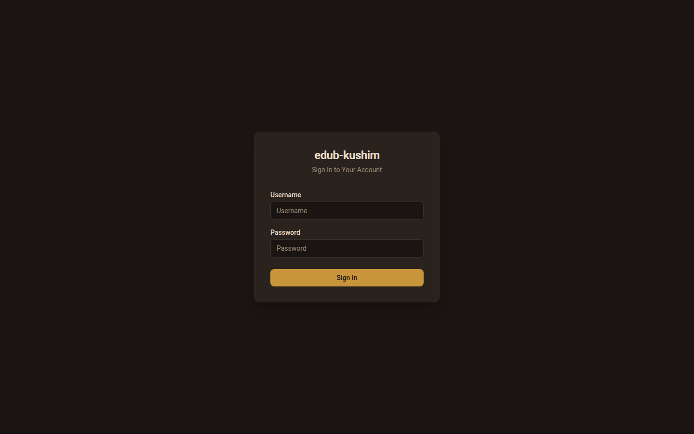

**Roles.** Three roles gate what is visible — the full permission matrix lives in the
generated API reference's [Authentication intro](../api.md#authentication); in the UI it
appears as three rules:

| Role | What the UI shows |
|---|---|
| `viewer` | Everything read-only. Mutation controls are hidden, and the Trash and Orphaned pages show *"You do not have permission to view this page."* |
| `editor` | All mutations: uploads, document edits, batch actions, trash restore/purge, orphaned-file handling, tag/people/type moderation, saved-search management |
| `admin` | Everything, plus the **Logs** and **Settings** nav items (both denied page-level for lower roles) and user management under Settings → Access |

Passwords are set at user creation (Settings → Access, or `kushim user create`) with a
12-character minimum including uppercase, lowercase, digit and special character.

## Navigation

The left sidebar lists, in order, with their role condition:

| Item | Route | Visible to |
|---|---|---|
| Dashboard | `/` | everyone |
| Documents | `/documents` | everyone |
| Orphaned & Errored | `/documents/orphaned` | editor+ |
| Trash | `/trash` | editor+ |
| Tasks | `/tasks` | everyone |
| Tags | `/tags` | everyone |
| People | `/people` | everyone |
| Document Types | `/document-types` | everyone |
| API Docs | `/docs` | everyone |
| Logs | `/logs` | admin |
| Settings | `/settings` | admin |
| Profile | `/profile` | signed-in users (only when auth is enabled) |

The top bar carries the signed-in username with **Profile** and **Logout**, and — for editors —
an **Upload** button that opens the upload dialog from any page. When required external tools
are missing, an amber banner (*"N required tool(s) not installed — document consumption is
paused"*) appears under the top bar and links to Settings → Processing.

## Pages

### Dashboard

The landing page, with a manual auto-refresh toggle (10-second interval when on):

- A summary row: files waiting in the inbox, storage sizes.
- **Active tasks** — the running strip, processing first.
- **Recent batches** — the ten newest with per-status counts and owner state.
- **Document analytics** and **processing health** when data exists.
- **Storage** — original-type breakdown and the storage trend.
- **Recent documents** — the fifteen newest documents as a clickable grid.

Every batch and task shown links to its detail view on the Tasks screen.

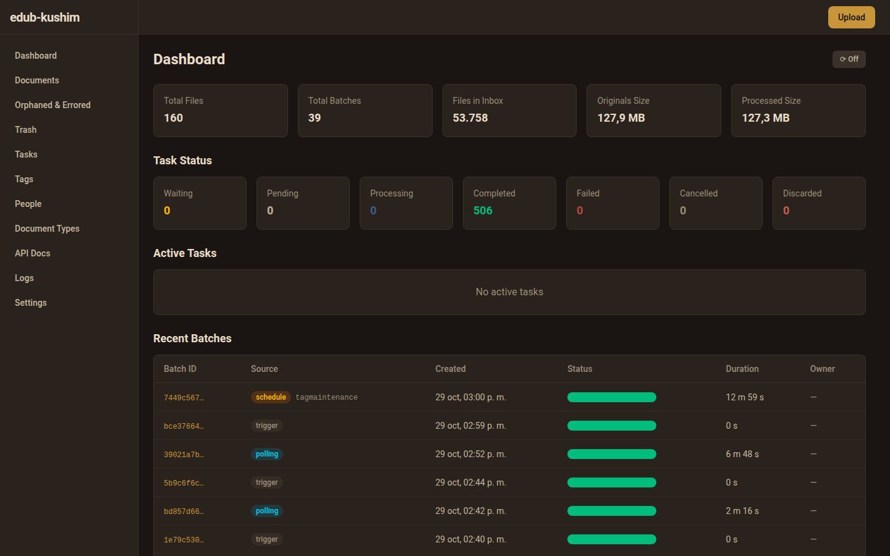

### Documents

The library view: a structured search bar, a collapsible filter panel, saved searches, sort
and pagination over a table or a grid of lazily-loaded thumbnails.

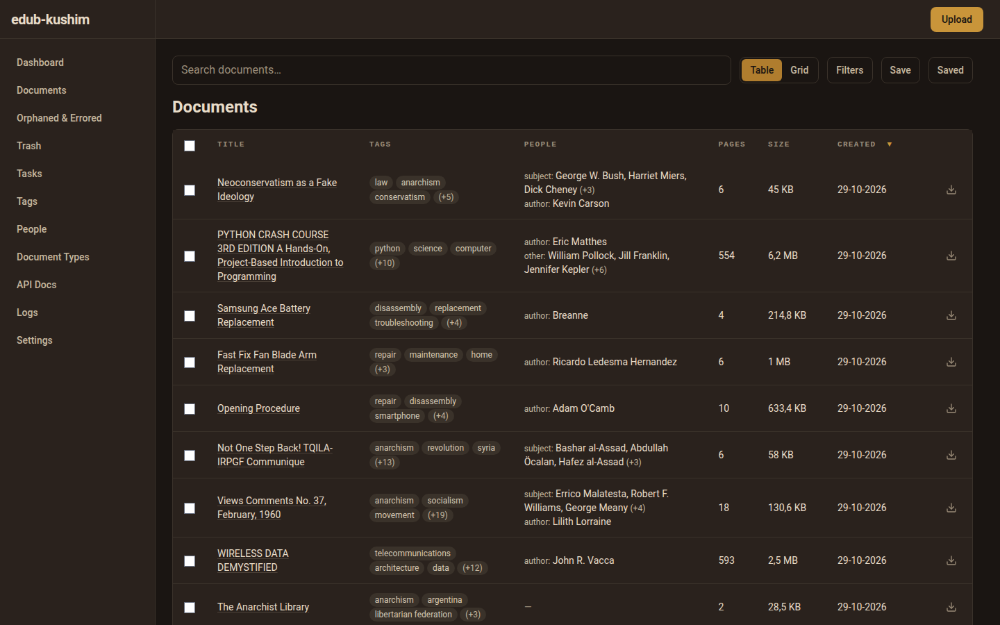

**Search syntax** — the search bar accepts `field:value` tokens alongside free text:

| Token | Meaning |
|---|---|
| `tag:finance` | Carries that tag (repeat for AND) |
| `type:invoice` | Document type |
| `lang:eng` | Language |
| `person:"John Doe"` | Person, any relationship type |
| `author:John` | Person with that relationship type (any configured person type works as a field) |
| `created:2026-01-01..2026-03-31` | Date range (`..`); same for `modified:` |
| `size:>=1MB` | Size bound — `>`, `>=`, `<`, `<=` or plain value, units `b`/`kb`/`mb`/`gb` |
| `missing:lang` | Also `missing:type`, `missing:tags` (untagged) |

Quote values containing spaces (`tag:"annual report"`). The query is mirrored into the URL,
so a filtered view can be bookmarked and shared.

**Filter panel** — the same fields as point-and-click controls: Tags (searchable), People
(type + name), Document type, Language, Date Created / Date Modified (from/to), File size
(min/max, e.g. `1MB`), and the Missing Language / Missing Type / Untagged checkboxes.

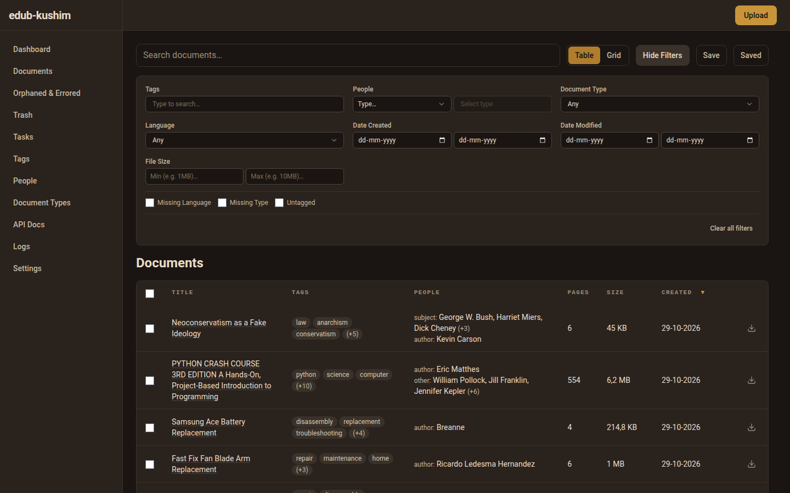

**Saved searches** — *Save* stores the current query and filters under a name; the list
applies or (for editors) deletes entries.

**Batch actions** — select rows with the checkboxes, then for everyone: *Download selected*
(zip). Editors additionally get batch *Delete* (moves to trash), a tag picker (add/replace
across the selection) and a document-type picker.

Editors mutate inline elsewhere too; viewers simply never see those controls. Opening a row
leads to the document detail page.

### Document detail

Two panes: the document itself and its metadata.

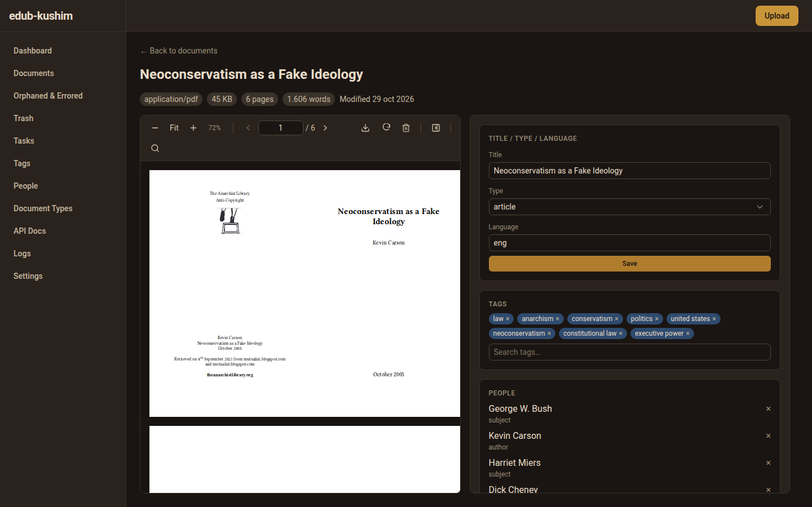

- **Viewer** — a self-hosted pdf.js viewer: continuous scrolling with lazy rendering, zoom,
  page jump, and find-in-document, over a per-page canvas with a selectable text layer.
- **Metadata** (editors) — title, document type and language, plus tag chips (add/remove with
  autocomplete) and people entries with their relationship types. Everyone sees the same
  panel read-only; *Download* is always available, *Delete* (soft — moves to trash) is not.

### Orphaned files

`/documents/orphaned` — editor-only — manages files found in the storage tree without a
document row, in two tabs (`?tab=orphaned` / `?tab=errored`):

- **Scan** runs detection and quarantine (the count comes back in a toast).
- Per file: **Restore** (creates a consume task that re-ingests it), **Move to inbox**,
  **Delete**; plus **Delete all** behind a confirmation for the pending list.
- The *Errored* tab lists files whose processing failed (quarantine), with their reason.

The same seven actions exist on the CLI — see
[`kushim storage orphans`](cli.md#kushim-storage-orphans-action).

### Trash

Editor-only. Lists soft-deleted documents (newest deletions first) with **Restore** per row
and a **Purge** action that permanently deletes everything older than
`storage.trash.retention_days` (default 30 days; the same purge runs hourly in the
background). A purged document is gone for good; a restored one returns to the library with
its files. Trashed documents are excluded from search, counts and duplicate detection.

### Tasks

Monitoring for batches and their tasks.

- **Batch table** — status, origin badge, per-status task counts, lease owner. Editors get
  per-row actions: **Retry** (failed batches in a resumable status), **Resume**, and
  **Cancel** (confirmation required). Resumable statuses are the ones the API accepts:
  `failed`, `completed`, `cancelled`, `paused`.
- **Task table** — reached by filtering with `?status=<batch-status>` or `?batch=<id>`;
  columns are type, payload, status, created/started/completed. Clicking a task opens
  `/tasks/{id}`, its detail page with the error text when it failed.
- `?task_status=<task-status>` narrows the list, and the choice is kept in the URL.

A `paused` batch means an LLM credit/balance error — fix billing, then resume
([api.md](api.md#ingest-and-monitor)).

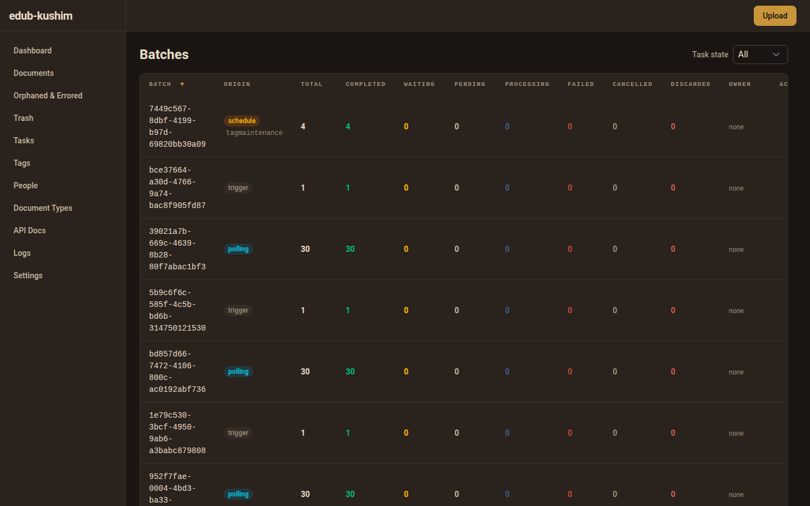

### Tags

The vocabulary workspace with five tabs, deep-linkable by hash (`/tags#provisional`):

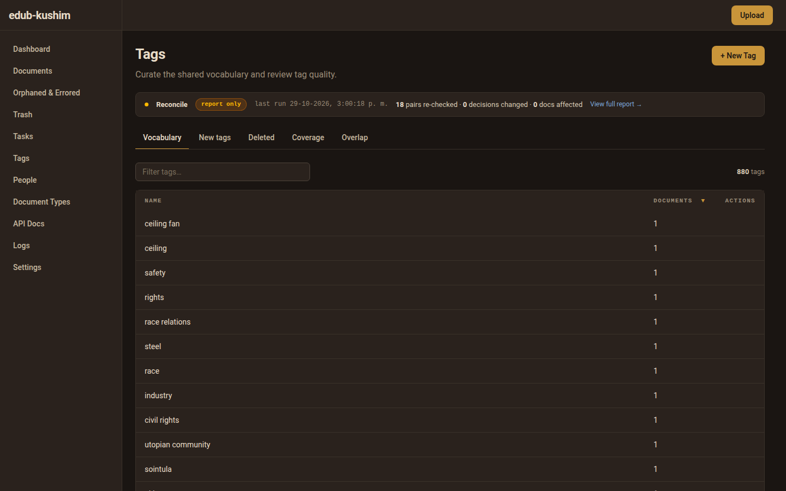

| Tab | Contents |
|---|---|
| **Vocabulary** | All tags with counts and standing; editors can create, rename and demote from here; `?q=` filters |
| **New tags** (provisional) | The review queue: rubric verdicts, identity/composition holds, promote or reject per tag, filterable by criteria and verdict |
| **Coverage** | Open coverage flags from the audit pass — apply, dismiss, or register a missing name |
| **Overlap** (siblings) | Near-containment pairs from the latest measurement; `gray` marks the review band |
| **Deleted** | The blocklist of rejected names, restorable |

Moderation actions require the editor role; the queue and reports are readable by viewers.
Review decisions are described in the [tag review workflow](api.md#tag-review).

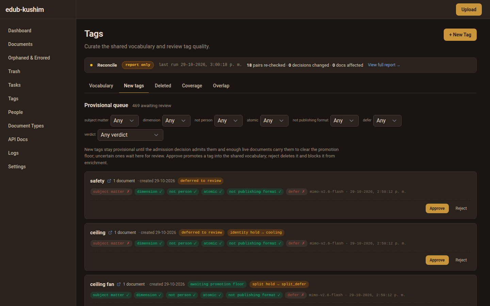

### People and Document Types

Two administration tables. **People** lists persons with document counts and a search box;
**Person Types** manages the relationship types (`author`, `sender`, …) with descriptions.
**Document Types** lists types with document counts. Editors get create/edit/delete on both;
deleting a type that documents still use is refused with a conflict the dialog surfaces.

### Logs

Admin-only. Four tabs — **Kushim**, **Edub**, **Hugot**, **Queue** — one per process log
file, with a line-count control (default 500), an auto-refresh toggle, and expandable lines
for the full message. The selected tab and line count live in the URL (`?tab=&lines=`). If
logs are empty, the corresponding daemon has not run yet on this installation.

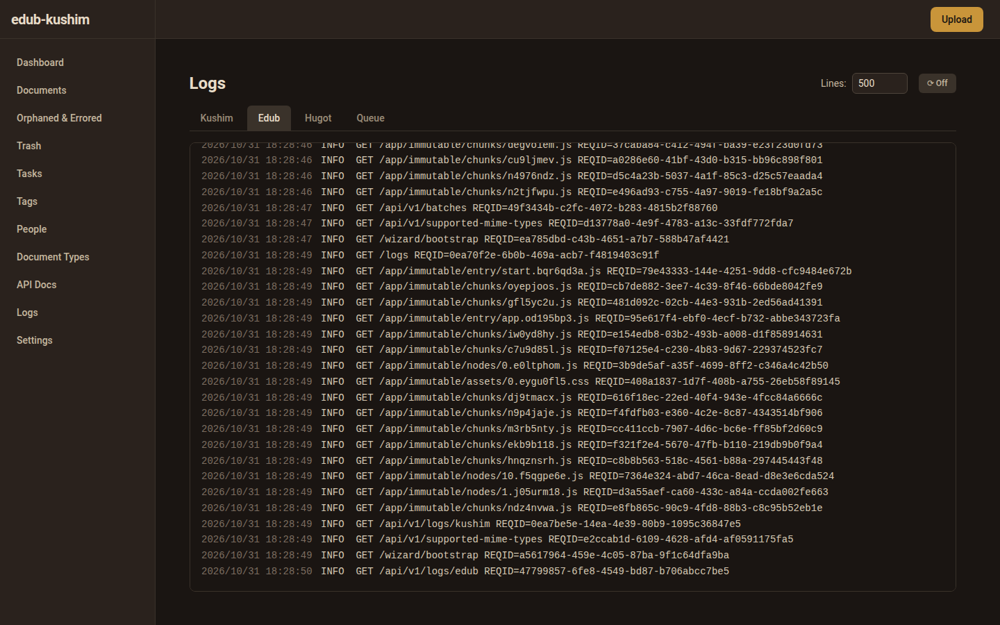

### Profile

The signed-in user's own page: account details and **API key** management — *Generate*, then
*Rotate* or *Revoke*, each behind a confirmation dialog. The raw key is displayed once after
generation or rotation; only its prefix is ever shown again. Use it as the
`Authorization: Bearer` header from scripts ([api.md](api.md#use-a-personal-api-key)).

### API Docs

`/docs` renders the server's own OpenAPI specification with Scalar — the live, always-current
endpoint reference. Any authenticated user can open it; the prose reference is
[docs/api.md](../api.md).

## Settings

Admin-only (`/settings`; non-admins get the permission message). Configuration is organized
as a **hub** plus one focused page per area:

| Page | Path | Covers |
|---|---|---|
| Intake | `/settings/intake` | uploads & server, watched inbox, accepted file types, office converter |
| Processing | `/settings/processing` | OCR, text extraction, PDF optimizer, thumbnails, throughput & recovery |
| Enrichment | `/settings/enrichment` | content analyzer, tag matcher, adjudicator, quality, reconciliation, measurement, workers |
| AI providers & models | `/settings/models` | the provider/model catalog (master–detail editor) |
| Storage | `/settings/storage` | directories, trash retention, database connection |
| Safety | `/settings/safety` | backups (per-mode schedules), mirror |
| Access | `/settings/access` | sign-in toggle, user management |
| System | `/settings/system` | logging and rotation |

Legacy links still land correctly: old section hashes (`#intake` … `#system`) and
`?tab=Users` redirect to their page.

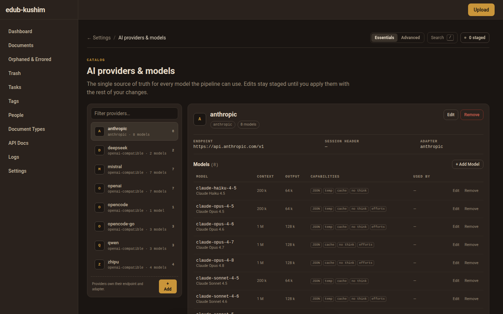

### The hub

`/settings` opens with a health summary, the toolchain overview (every external tool the
pipeline calls, with availability badges, install hints, and an *N of M* counter), and the
pipeline map — *How a Document Moves*: Intake → Processing → Enrichment → Storage, each with
a status and click-through. Destination rows are grouped into **The pipeline**, **Catalog**
(providers · models) and **Operations** (safety and system), and each area shows a pending
badge while it has staged changes.

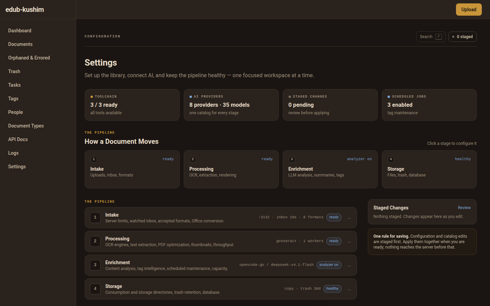

### The settings header

Every settings page shares a pinned header: a breadcrumb back to the hub, the
**Essentials/Advanced** toggle (persisted per browser — Advanced reveals expert controls
such as request tuning, the prompt template, the tessdata directory, polling windows,
thumbnail backfill and the database container name), the staged-changes pill, and the
command palette (`/` or `Ctrl+K`) for jumping between pages and settings. `Esc` closes the
palette.

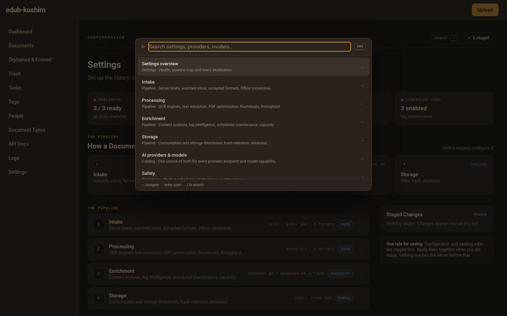

### Staged apply: review tray → Apply Changes

Nothing reaches the server while you edit — every change is staged locally first:

1. **Stage** — edits (and catalog add/edit/remove operations) accumulate; the header pill
   and the hub's per-area badges show the pending count.
2. **Review** opens the changes tray: changes grouped by page with previous and new values.
   Secret keys (`*.token`) are never shown in clear — only that their value changed.
   Individual configuration entries can be discarded one by one; catalog operations are
   listed in replay order.
3. **Apply Changes** saves the configuration first, then replays the catalog operations in
   order. A catalog operation that fails keeps its entry staged with the server's reason
   (*"Some catalog changes could not be applied: … They remain staged."*); the rest still
   applies.
4. **Discard All** (confirmation dialog) restores the last saved configuration and reloads
   the catalog from the server.

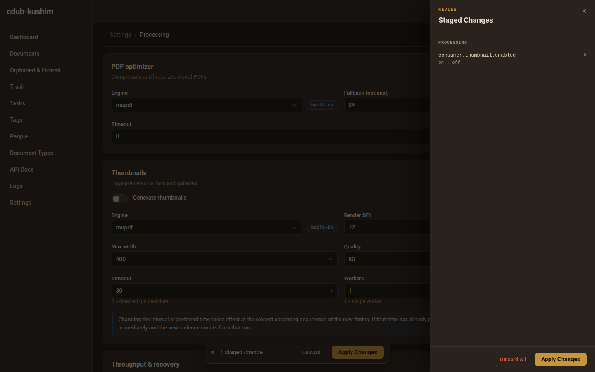

Database-connection and storage-directory changes are deferred instead of written directly:
the save queues a migration task, a toast reports *"Migration queued — settings apply once it
completes"*, and the page polls the config status until it settles — *'Migration applied.'*
on success, or *"Migration failed: … — settings kept their previous values."* with the
previous values restored. Leaving the site with staged changes triggers the browser's
unsaved-changes warning.

Applying also starts direct config updates for any missing tessdata or Hugot model files,
with a spinner and pending-work counter, and (for API clients) the same flow lives at
[`PUT /wizard/config`](api.md#settings-apply).

### Tool-status warnings

Beneath each engine selector, an inline warning appears when the selected external tool is
missing from `PATH`. With the `ocrmypdf` engine, advisory blocks list the system tesseract
language packs for the configured languages and the status of the companion tools
(`tesseract`, `unpaper` required; `pngquant` optional) with install hints. The top-of-app
amber banner is the same signal at global scope.

### Field highlights per page

- **Intake** — uploads & server (host, port, size/count limits, max concurrent batches),
  watched inbox (polling toggle, interval, active windows), accepted file types (PDF always
  on), office converter (DOCX/ODT toggle, binary, timeout).
- **Processing** — OCR (engine with availability badge, timeout, language chips, tessdata
  directory, workers), text extraction, PDF optimizer (engine, fallback, timeout), thumbnails
  (enabled, engine, DPI, max width, quality, timeout, workers, backfill interval/time),
  throughput & recovery (consumer workers, max files per batch, auto-resume, max retries,
  stale task).
- **Enrichment** — content analyzer (enabled, timeout, min/max tags, adapter → provider →
  model cascading selectors, token with show/hide, temperature, pause-on-credit-error,
  request delay, prompt template, doc-type refinement, fallback LLMs with reorder), text
  reducer, tag matcher (timeout, reduce target words, chunk size, model, backend), tag
  adjudicator and tag quality (each can inherit the analyzer's model), tag reconciliation and
  measurement schedules, enrichment workers. An at-a-glance strip links to the catalog page.
- **Models** — master–detail: filterable provider pane (`?provider=` deep-link), model table
  with capability chips and a *Used by* column; add/edit/remove side panels stage catalog
  operations (they apply with **Apply Changes**, not immediately); *Restore Default Catalogs*
  sits in a danger section and replaces both catalog files after a confirmation.
- **Storage** — directories (consumption, storage, migration mode with a warning for `move`),
  trash retention, database connection (host/port/user/name/ssl mode, runtime with
  container name).
- **Safety** — backup schedules per mode (interval, preferred time, keep count, optional
  path), mirror (destination local or `[user@]host:path`, interval, rsync warning).
- **Access** — sign-in toggle; the users table with create/edit/delete (password policy
  enforced) and pagination.
- **System** — log level, rotation (max size, backups, age, compression).

## Setup wizard

Before the main UI exists, `kushim setup` serves a standalone wizard at
`http://0.0.0.0:8420` (or the terminal with `--cli`). Its six steps: config directory →
consumer settings (OCR engine, languages, workers, file types, converter) → enricher settings
(provider/model, matcher, reducer; this step claims the database and applies the schema) →
asset downloads (tessdata, Hugot model, with progress) → optional admin user → done, ready to
start `edub`. The same bootstrap API backs it; see
[api.md](api.md#settings-apply).

## Related documents

- [api.md](api.md) — the same workflows over REST
- [cli.md](cli.md) — terminal equivalents (`kushim batch`, `kushim storage orphans`, logs)
- [configuration.md](configuration.md) — every key the settings pages edit
- [docs/frontend.md](../frontend.md) — route and key-file map for developers
