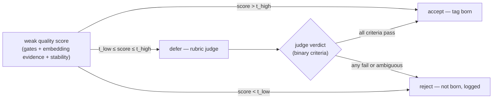
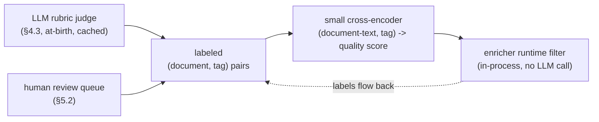
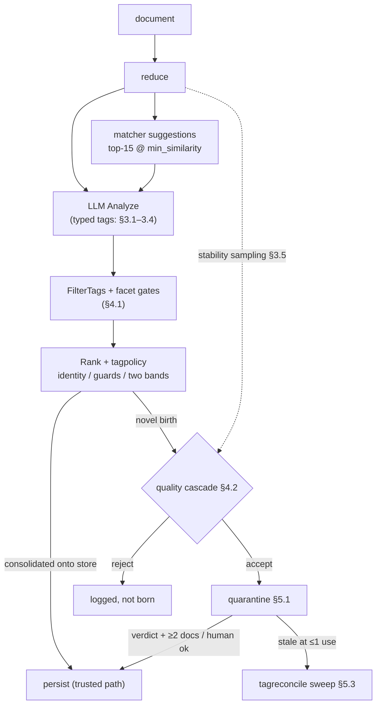

# Tag Quality Control — Mechanisms for Improving LLM Tag Generation and Rejecting Useless Tags

Research note. Survey and synthesis only: mechanisms that could be attached at any
point of the enrichment pipeline to improve the quality of LLM-generated tags or to
reliably reject useless ones before they pollute the vocabulary. The motivating
defect, measured on a production copy of the database (snapshot 2026-09-14), is
trash-tag proliferation: the tag-consolidation policy rewrite solved wrong merges —
97.4% of all tag assignments still ride on the pre-rewrite vocabulary — but the
re-enrichment pass that followed created 9,144 new tag rows of which 1,333 attach to
exactly one document and 7,107 to none, while the healthy core (1,410 tags with more
than 10 uses) grows by almost nothing. The residue is not an equivalence problem
(consolidation now answers that); it is a **birth-quality** problem: which novel
terms deserve to enter the vocabulary at all. Sources are drawn from keyphrase
generation and its evaluation, LLM judging and verification, semantic-entropy and
conformal-prediction methods, automated subject indexing in library science, and
production tag-recommendation systems. This note is orthogonal to
`tag-relationship-architectures.md` (typed relations *between* tags); here the
question is the quality of a tag *becoming* a tag.

---

## 1. The observed defect — evidence snapshot

Production copy, 51,882 documents, 231,756 tag assignments, 13,630-tag vocabulary.

| Metric | Pre-rewrite tags | Post-rewrite tags (created ≥ 2026-09-10) |
|---|---|---|
| Tag rows | 4,486 | 9,144 |
| Current assignments carried | 225,751 (97.4%) | 6,005 |
| Tags with >10 uses | 1,410 | 69 |
| Tags with 1 use | 1,202 | 1,333 |
| Tags with 0 uses | 1 | 7,107 |

The 2026-09-13 re-enrichment created 8,581 tags in a single day; a subsequent pass
cleared most of those assignments, leaving the 7,107 zero-use orphans (a pure
hygiene worklist — §5.3). The distribution tail is the story: the rewrite's
consolidation layer maps nearly every emission onto the existing vocabulary, and
what escapes it is a thin spray of singletons. Four distinct failure modes appear
in the recent tail:

- **F1 — thesis-compression tags.** `racial scapegoating` (for *The Opioid Crisis —
  White Despair and the Scapegoating of People of Color*), `monogamy critique`,
  `criminal injustice`, `social death`, `moral agency`, `organizational
  dissolution`, `elite privilege`, `structural power`, `self improving systems`,
  `cognitive drives`. The document's *argument* compressed into a per-document
  coinage: faithful to the content, but a phrase no other document will ever emit,
  so it can never recluster.
- **F2 — form/genre tags.** `literary anthology` (*No Gods, No Masters: No Thanks*),
  `literary essay`, `moral fable`, `moral tales`, `personal letters`, `film
  adaptation`, `spectatorship`, `chinese literature`. They describe what the
  document *is*, not what it is *about* — and the schema already owns that facet:
  `document_type`, a closed, LLM-constrained list.
- **F3 — rule-violating leaks.** `newfoundland`, `libya`. The prompt template
  (`internal/tools/adapters/contentanalyzer/shared.go:131`) already states *"Tags
  are conceptual categories — fields, domains, disciplines, periods, methods. Tags
  are never specific people, works, or places."* The leaks pass anyway.
- **F4 — wrong-granularity device tags.** `spinning reel repair`, `bail spring
  replacement`, `calculator teardown`, `segway maintenance` — legitimate topics for
  a repair-manual corpus, born at a granularity that never recurs while healthy
  broad tags (`device disassembly` ×15,365, `electronics teardown` ×7,803,
  `smartphone repair` ×6,404) already cover the domain.

F3 — and the spirit-violations in F2 — are the decisive observation: **prompt-side
control has saturated.** The conceptual-categories clause and the Stage-1
standard-terminology sentence are already in the template, and the leaks persist.
Better wording will not close this; the mechanisms below assume that and work on
the output instead of the input.

---

## 2. Why prompt-side control saturates

Three results from the keyphrase literature frame the defect precisely.

### 2.1 The risk zone is "absent" phrases

In keyphrase terms, tags that follow the matcher's suggestion list are *present*
phrases; every observed trash tag is an *absent* phrase — invented by the model
rather than copied. The analysis of neural keyphrase generation shows models are
markedly less confident and significantly worse calibrated on absent vs. present
phrases, and that pretrained seq2seq models are systematically overconfident (ECE
up to ~37 on KP20k) [4] — so even the model's own token-level confidence cannot be
trusted to self-regulate, and neither can an instruction: instruction adherence on
open-ended generation is exactly the capability that degrades in the absent-phrase
regime.

### 2.2 "Relevant to the document" is the wrong test

KPEval decomposes keyphrase quality into four aspects: reference agreement,
**faithfulness** (grounded in the document), **diversity** (distinct concepts,
minimal repetition), and **utility** (does the keyphrase actually help retrieve the
document in-domain) [3]. `racial scapegoating` and `literary anthology` are
*faithful* — the document genuinely is about, respectively is, those things. They
fail standardness (they are per-document coinages, not shared subject vocabulary)
and utility (a tag used by exactly one document contributes nothing to retrieval
clustering). A quality gate must therefore test standardness and utility, not
relevance alone — relevance-only judges would wave F1 and F2 through.

### 2.3 Verification is the easier, scalable half

The LLM-as-a-Verifier work shows that candidate pools almost always contain the
good answers (oracle pass@K reaches 98.9% when pooled across a leaderboard), so the
bottleneck is *selection*, not generation; and that judge accuracy improves along
three cheap axes — scoring granularity, repeated evaluation, and **criteria
decomposition** (several simple binary judgments beat one complex one) [5]. The
practical translation for tags: a model cannot reliably self-classify its output
while freely generating it, but a separate pass asking *"is this a subject rather
than a form? is this standard terminology?"* is a fundamentally more reliable
operation than *"generate five good tags obeying eight rules."* The entire §4
toolkit rests on this asymmetry.

---

## 3. Generation-time mechanisms

### 3.1 Typed structured output

Extend the JSON contract from `"tags": ["..."]` to objects carrying the model's own
self-classification, so filtering runs on auditable fields instead of string
heuristics:

```json
{"tags": [
  {"term": "opioid crisis", "category": "topic", "is_standard_term": true,
   "rationale": "the document's central subject"}
]}
```

`category ∈ {topic, form_genre, place, person, other}` plus a standardness flag
turns F2 and F3 into fields the §4.1 facet gate enforces deterministically. This is
the form-filling evaluation pattern
of G-Eval [32] and the criteria-decomposition effect of [5]. The adapters already
parse arbitrary shapes (`AnalysisResult`), and `response_format: json_object` is
already sent where the model catalog supports structured output.

### 3.2 Facet-separated generation

Ask for topics and for "what the document is" in separate fields; only the topic
field becomes tags; the form field is either dropped or reconciled against the
existing `document_type` facet. Professional cataloging maintains exactly this
separation: subject indexing analyzes *aboutness* as its own skill [22], and the
Library of Congress discontinued form subdivisions in LCSH in favor of the separate
LCGFT form/genre thesaurus (655 fields) [22, 23]. Genre information is not lost —
it lands in the facet that already exists.

### 3.3 Retrieval-first generation: choose-or-justify

The matcher's suggestion injection (top-15 at ≥ `min_similarity`, injected by
`tagsPrompt`) is currently a *preference*. Strengthen it into a *contract*: every
tag must either come from the suggestion list or be an explicitly justified novel
term. The closest direct evidence is LLMFT-CVR [20]: a fine-tuned LLM generates
initial terms, **embedding retrieval pulls candidates from the controlled
vocabulary**, and a re-ranker selects the final terms — beating pure fine-tuned LLM
generation by ~4 points F1 and RAG by ~14.7, while explicitly "mitigating
hallucinations in the generated terms." The closed loop stays content-driven: the
"controlled vocabulary" is the tag store itself, which grows from the corpus — no
external seed, preserving the consolidation design's rejection of static catalogs.
The Stack Overflow tag-recommendation literature converged on the same shape
independently: formulate tagging as closed-set multi-label prediction over an
existing tag set, precisely because free-form tagging produces "tag ambiguity and
tag explosion" [24, 25] — the exact term for the §1 tail.

### 3.4 Few-shot negative exemplars

A compact block of canonical rejections with reasons (`literary anthology` — form,
not subject; `racial scapegoating` — per-document coinage, not a shared term).
Production evidence favors small, fully-specified prompts over elaborate
instruction lists: eBay's judge is a minimal binary prompt, and it is what survived
contact with 2.3 billion items [1].

### 3.5 Multi-sample stability filtering

Sample the tags field k = 3–5 times (short outputs; the Anthropic adapter already
sets `cache_control: ephemeral` so the shared document prefix is cached), then keep
only tags whose *meaning* recurs across samples. This is self-consistency [28]
repurposed as a filter; semantic entropy is the principled version — cluster
sampled outputs by meaning (bidirectional entailment) and treat high cluster
entropy as unreliability [8]. It has been deployed as a rejection filter in
production radiology VQA: 15 samples per question, entailment-clustered, unstable
questions rejected, accuracy improved [9]. Critically for this pipeline:
**embedding-based clustering of sampled phrases matches NLI-based clustering at
much lower cost** [10] — and bge-m3 through the hugot daemon is already deployed to
do exactly that clustering. F1 thesis-tags are the low-stability population by
construction: re-sample the same document and the model coins a different
compression each time.

### 3.6 Constrained decoding to the candidate set

Grammar-constrained decoding can hard-force `term ∈ suggestions ∪ {NEW}`. Possible
but provider-dependent across the six catalog vendors; §3.3's prompt contract plus
the §4 filters capture most of the value portably.

---

## 4. Post-generation verification, before persistence

### 4.1 Deterministic weak gates

Free, first, and with the last word — the position argued in *LLM-as-a-Judge Is Not
an Oracle* [19]: deterministic guardrails over stochastic judges. This extends the
existing `FilterTags`/`NewTagFilter` layer (`shared.go`), which already drops tags
over three words, people-name overlaps, document-type token overlaps, and title
containment. Hard gates belong **only** where classification is unambiguous — facet
confusion — and their signal is the generator's own per-tag self-classification,
not any curated list:

- **self-classification enforcement — kills F2 and F3.** The `category` field of
  the §3.1 typed output: the model's in-context judgment of whether each tag names
  a subject, a form/genre, a place, or a person. Enforcement is a deterministic
  string comparison on an already-parsed field: `form_genre` is not born as a
  topical tag (its information already lives in the `document_type` facet, or an
  explicit genre facet per §7.1); `person` is not born either (persons already
  have the People facet); `place` is born only when the term denotes a country or
  a continent (§7.2).

A curated form-heading list or a gazetteer would be wrong twice over. It would be
**wrong by construction**: form-vs-topic is a property of the tag *relative to the
document* — `letters` is a form tag on a correspondence collection and a topic tag
on a history of letter-writing — so a word list decides by surface form what only
context can decide. And it would be **unmaintainable in the exact way this design
has already rejected**: static, out-of-band curation that silently rots and hands
the rest of the pipeline a false sense of coverage — the same grounds on which the
consolidation design rejected a seeded canonical vocabulary (§3.3's content-driven
stance applies verbatim). The self-classification route also fails safely (§8): a
mislabeled topic is rejected rather than born, re-emerges on the next document, and
its misclassification rate is measurable through the §5.2 review queue instead of
rotting invisibly in a list. That the field can be gated on at all rests on §2.3's
asymmetry: the same model that cannot reliably *obey* "never emit places" while
generating freely (§1, F3) can *classify* its own emission under a forced choice.

The place branch is the one curated set this design accepts: a fixed,
document-independent whitelist of countries and continents. It does not decide
whether a term is a place — the model's `category` does that — only whether a
`place` is of tag-worthy scope (a country or continent) rather than a
sub-national one. Being bounded and universal, it lacks the document-relative
failure modes that rule out a form-heading list, and a miss is a visible drop
on the enrichment log rather than a silent no-op.

Everything fuzzier should feed a *score*, not a hard reject — and the score's
inputs are pattern classes of the language, not curated word lists:
abstract-nominal head morphology (`critique`, `agency`, `scapegoating`,
`dissolution` as head noun with no store anchor), generic single-word tags
(`thought`, `knowledge`, `irony` — visible in the zero-use orphan sample),
token-IDF specificity. The weak–strong verification
analysis [6] explains why: the value of a cheap verifier is governed by its
**calibration** and **sharpness**, and a blunt gate on a fuzzy signal destroys
sharpness (near-coin-flip cases land in the reject band and get no strong
verification).

### 4.2 The two-threshold cascade

The formal shape for the whole verification layer [6]: a weak verifier with a
**two-threshold structure** — auto-accept above `t_high`, auto-reject below
`t_low`, defer to the strong verifier only in the middle band — with an online
algorithm that provably controls both error types without distributional
assumptions. This is the same architecture the consolidation rewrite already
employs for replacement (deterministic guards → auto-replace ≥ 0.95 → adjudicate
the ambiguous band); §8 composes the two cascades.



The auto-accept band is not new machinery: tags that followed suggestions, or that
consolidated by identity / auto-replace, are already trusted. The cascade's real
addition is the reject band and the bounded defer band.

### 4.3 A rubric judge for newborn tags only

One extra LLM call per document, **only when novel tags survive consolidation**,
judged on decomposed binary criteria (per the criteria-decomposition effect [5]):

1. subject matter, not form/genre?
2. standard, widely-recognized terminology — not a per-document coinage?
3. not a person, place, or work?
4. appropriately broad for a shared vocabulary?

This is the LLM-as-a-judge pattern [31] with the verification-scaling levers of
[5] applied. Production evidence is strong: eBay runs this exact pattern at scale — a
general-purpose LLM judging keyphrase–item relevance with a binary prompt, ~90%
concordance with click-derived human signals, and a downstream distilled filter
that cut 68% of recommended keyphrases while *increasing* sales 10% [1]. Cost here
is bounded by construction, the same way the tag adjudicator's band is: one call
per document that births a novel term, verdicts cached per tag name across
documents (the `tag_verdict_event` pattern generalized to a `tag_quality_event`
table, pinned to `tagpolicy.Version`), so a full-corpus re-enrichment pays per
*distinct new term*, not per assignment.

Judge hygiene, each rule evidence-backed:

- **judge model ≠ generator model** — self-preference bias [1, 11];
- **the judge sees the same reduced text the generator saw** — eBay's
  modality-parity error analysis: mismatched inputs silently poison every label
  produced downstream [1];
- **pin `verdict_model` + `policy_version`, re-validate on upgrades** — judge
  replacements change the measurement itself; scores move when the evaluator
  changes even though the candidates do not [13];
- **temperature 0 is not determinism** — borderline items flip pass/fail across
  identical runs; repeat and treat disagreement as a first-class signal [12];
- **allocate repeats by variance, not uniformly** [14];
- **style bias, not position bias, dominates current judges** — binary rubric
  criteria rather than free-form grades [11].

### 4.4 Entailment grounding

A boolean-QA consistency check ("Is this document about X?") is the
best-performing automatic *faithfulness* metric in KPEval's meta-evaluation (the
UniEval-style consistency formulation) [3], and bidirectional entailment is the
clustering primitive of the semantic-entropy line [8, 9]; sample-and-compare is the
SelfCheckGPT pattern [33]. Necessary but not sufficient: F1 and F2 tags are
faithful. Its role is catching unfaithful leaks — complementary to the standardness
criteria, which is where F1/F2 actually die.

### 4.5 Conformal calibration of the accept cut

Wrap the judge with conformal prediction so the accept/reject threshold carries a
distribution-free guarantee: calibrate on a small human-labeled set so that the
*accepted*-tag error rate stays ≤ α. The line is well developed: adaptive,
prompt-dependent conformal filtering of LLM outputs with selective prediction [15];
a 106-study Royal Society review of conformal prediction for LLMs — with the
directly relevant finding that **logit-free signals (self-consistency, semantic
diversity) outperform token-probability signals**, sidestepping miscalibrated
logprobs [16]; accept/reject/defer with finite-sample risk control [17]; and
judge + conformal interval evaluation [18]. Operationally, α becomes an
operator-tunable tolerated bad-birth rate, and the calibration set comes from the
§5.2 review queue.

---

## 5. Persistence-time lifecycle

### 5.1 Quarantine and promotion for newborn tags

New tags are attached and searchable from birth — the born-on-first-emission
self-healing property of the consolidation design is untouched, and replacement
semantics do not change. What is gated is **vocabulary influence**, not existence:
a newborn enters a *provisional* state in which it is not injected as a preferred
suggestion in future prompts (or is de-weighted), and it carries no UI prominence.
Promotion out of quarantine requires a quality verdict (§4.3) **plus** usage by at
least two distinct documents, or explicit human approval.

This is deliberately not the frequency escape-hatch rejected during the
consolidation design, and the distinction matters enough to spell out. That
proposal used emission counts to decide *replacement* — frequency overriding
concept-identity decisions, with a cold-start window and a spam reward ("a
repeatedly emitted garbage term gets promoted to a permanent tag"). Here frequency
never decides anything about equivalence; it only gates how much the vocabulary
trusts a newcomer, and the spam critique is answered structurally: the count alone
promotes nothing, because the judge verdict is a conjunctive requirement. The
promotable signal space can also include KPEval's utility metric — does the tag
retrieve its own document in-corpus — computable with the existing search
infrastructure [3].

### 5.2 A human review surface

A "review new tags" queue beside the existing merge-review surface: newborns with
their judge verdicts, binary approve/reject. eBay's annotation protocol is the
template, and their error analysis is the warning: binary labels worked; graded
four-level labels (excellent/good/fair/bad) *hurt*; and ~150k annotations with
input mismatch actively poisoned their downstream fine-tuning [1]. These labels
feed the conformal calibration set (§4.5) and the distillation training set
(§6.1).

### 5.3 Scheduled hygiene sweeps

The `tagreconcile` scheduler and event-table machinery extend naturally: sweep
provisional tags older than N days still at ≤ 1 use → re-judge, merge, or delete.
The 7,107 zero-use orphans from the 2026-09-13 pass are a ready-made first
worklist — zero risk, pure cleanup, and a direct measure of how much of the
singleton tail is recoverable versus noise.

---

## 6. Scale-out: distillation and preference optimization

### 6.1 Distill the judge into a cheap cross-encoder

The endgame for cost, and the strongest production result in this survey
(LLMDistill4Ads [2]): an LLM teacher labels (document, keyphrase) pairs; a small
**cross-encoder assistant** is distilled from the labels (a 2-layer bert-tiny
reached 96% F1 against the LLM labels, at ~100B-pair inference scale); a
bi-encoder student is distilled from the assistant, with a Pearson
rank-imitation loss the best objective; the online A/B measured +51% gross
merchandise value.



For this codebase: a small `(reduced-document-text, tag)` cross-encoder scoring
standardness/quality, running in-process in both binaries — the deployment vehicle
is the same ONNX-style local inference the rest of the tooling already uses, and
CGO_ENABLED=0 compatible. The at-birth LLM judge bootstraps its labels; the human
queue cleans them; the runtime LLM call then disappears.

### 6.2 Preference optimization of the generator

With clean labels, DPO-family training on (document, preferred-tag-set ≻
rejected-tag-set) pairs is the standard route — DPO [27], with the unification
survey [26] providing the method-selection axes and the failure modes to monitor:
length hacking, mode collapse, and likelihood displacement are all live risks for
tag *style*. Sequence it last. eBay's cautionary tale is direct: a fine-tuned judge
with better human κ (0.724 vs 0.258) *underperformed* the general-purpose judge on
production metrics — dataset bias amplifies through fine-tuning [1]. General-purpose
judge plus verification framework first; fine-tuning only on labels the review
queue has cleaned.

---

## 7. Facet-level structural fixes

### 7.1 Form/genre as a first-class facet

Consume F2 information through the facet that already exists (`document_type`) or
an explicit optional genre facet; reject topical-tag candidates that encode form.
The precedent is deep: aboutness and form are maintained as separate concerns in
subject indexing — LC now keeps form/genre in a separate thesaurus (LCGFT) from
topical headings [22, 23]. F2 then stops being a judgment call and becomes a
*misdirected facet* — something the generator itself can recognize in context
(§3.1) and the pipeline can enforce deterministically (§4.1).

### 7.2 Places

Same treatment: a geographic facet, or the §4.1 self-classification enforcement
(`category = place`) restricted to countries and continents from the fixed
whitelist. LCSH likewise
maintains geographic headings as their own machinery rather than mixing them into
topical strings [23].

### 7.3 Blanket splitting is the wrong version of a right instinct

The codebase already contains the nuanced version of "split multi-word tags":
`BuildTagSplitPrompt` / `ParseTagSplitResponse` / `SplitComponents` — an
LLM-adjudicated keep/split that explicitly protects "established proper names and
set phrases", wired into the enricher and the reconciler. Blanket splitting of
every multi-word tag into single words would:

- destroy set phrases (`machine learning` → `machine` + `learning`) — the
  normalization design (single-token `c++`) and the direction guard exist precisely
  to preserve such units;
- *increase* genericity — the zero-use orphan sample shows generic one-worders
  (`thought`, `knowledge`, `irony`, `commerce`) are themselves trash, and single
  words trend broader, not better;
- fight the consolidation semantics — token-subset relationships are what the
  direction guard encodes.

The evidence-aligned version of the instinct: keep the adjudicated split for
genuine conjunction joins; handle F4 granularity through quarantine/promotion (a
per-device tag that recurs *is* a legitimate tag — one that never recurs dies in
quarantine); and redirect head-noun overlaps to existing broad tags where embedding
similarity supports it.

---

## 8. A composed architecture for this pipeline



| Priority | Mechanism | Where it lands | Cost |
|---|---|---|---|
| P0 | facet gates (§4.1: self-classification enforcement + doc-type token overlap; needs the §3.1 typed output) | `contentanalyzer` filter layer | free |
| P0 | typed output, facet separation, choose-or-justify, negative exemplars (§3.1–3.4) | `defaultPromptTemplate` + parse validation | free |
| P1 | rubric judge on newborns, two-threshold cascade, verdict cache (§4.2–4.3) | enricher, after the consolidation policy keeps — the `tag_adjudicator` config pattern (default-off, timeout, own LLM block), new `tag_quality_event` table | one bounded LLM call per document with novel births |
| P1 | multi-sample stability filter (§3.5) — alternative or complement to the judge | enricher + hugot store clustering | k short cached completions per document |
| P2 | quarantine/promotion + review queue + hygiene sweep (§5) | tag lifecycle, tags-page UI, `tagreconcile` extension | small, scheduled |
| P3 | conformal calibration of the accept cut (§4.5) | on top of judge + review labels | one calibration pass |
| P3 | distilled cross-encoder filter (§6.1) | new small local-inference adapter, both binaries | offline training, ~zero runtime |
| P4 | preference optimization of the generator (§6.2) | outside the repo | only on cleaned labels |

One principle closes the loop with the consolidation design. That rewrite
established: *creation is the default; replacement requires positive evidence of
concept identity* — because a wrong keep is visible and mergeable while a wrong
replace is silent and permanent. Tag quality has the **mirror-image asymmetry**: a
wrongly rejected good tag is self-healing (the concept is re-emitted on the next
document and born then — the L3 property, intact), while a wrongly born trash tag
is permanent vocabulary pollution that crowds suggestion slots, grows the embedding
store, and erodes matching precision. The analogous principle is therefore:
**consolidation-following is the default; novel-tag creation requires positive
evidence of quality.** The §1 numbers quantify the stakes — 97.4% of assignment
mass already rides on the pre-rewrite vocabulary, so the marginal value of another
singleton is near zero while its marginal cost is real and compounding.

---

## 9. Failure modes the evidence demands designing around

1. **Judge ≠ generator.** Self-preference bias is measured, not hypothetical —
   use a different model family for the judge than the analyzer [1, 11].
2. **Judges are stochastic.** Temperature 0 does not make them deterministic;
   borderline verdicts flip across identical runs. Repeat, cache, and treat
   disagreement as signal [12].
3. **Fine-tuned judges can be worse than general-purpose ones.** eBay's paradox —
   better human κ, worse production outcomes; dataset bias amplifies through
   fine-tuning. Do not rush to fine-tune [1].
4. **Sampling beats reflection.** At equal token cost, repeated sampling with
   selection outperforms Self-Refine/Reflexion-style rewrite loops from 1.5B to 7B
   scales [7, 29, 30] — prefer filter-over-samples over asking the model to rewrite
   its own tags.
5. **Token-confidence gating is unreliable.** Keyphrase models are overconfident
   and miscalibrated on absent phrases [4], and conformal-LLM work finds
   logit-free signals beat token probabilities [16]. Do not build on logprobs —
   most of the catalog's providers do not expose them anyway.
6. **The long tail is partly legitimate.** At the German National Library,
   generative LLM methods *beat* extreme multi-label classifiers on graded
   relevance and long-tail subject suggestions [21] — a singleton today may be a
   healthy cluster tomorrow (`soviet agriculture` is arguably a fine tag). Hence
   quarantine-and-promote, never hard-block-on-rarity.
7. **Judge upgrades change the measurement.** Pin `verdict_model` +
   `policy_version` — the Stage-2 pattern — and re-validate when the judge model
   changes [13].
8. **Input parity.** The judge must see the same reduced text the generator saw;
   mismatched inputs poison every label produced downstream, silently [1].
9. **Style bias dominates modern judges; position bias has faded.** Binary rubric
   criteria, not free-form grades [11].
10. **Bound the cost structurally.** Judge only newborns (bounded by construction,
    as the adjudicator band is), cache verdicts per tag, and put the conformal
    guarantee on the *accept* side, which is where the pollution lives [15, 17].

---

## References

[1] S. Dey, H. Wu, and B. Li. "To Judge or not to Judge: Using LLM Judgements for
    Advertiser Keyphrase Relevance at eBay." Proc. ECAI 2025, Frontiers in
    Artificial Intelligence and Applications 413:5335–5343. arXiv:2505.04209.

[2] S. Dey, B. Braun, N. Ravipati, H. Wu, and B. Li. "LLMDistill4Ads: Using
    Cross-Encoders to Distill from LLM Signals for Advertiser Keyphrase
    Recommendations at eBay." arXiv:2508.03628.

[3] D. Wu, D. Yin, and K.-W. Chang. "KPEVAL: Towards Fine-Grained Semantic-Based
    Keyphrase Evaluation." arXiv:2303.15422.

[4] T. Kundu, J. Ray Chowdhury, and C. Caragea. "Neural Keyphrase Generation:
    Analysis and Evaluation." arXiv:2304.13883.

[5] J. Kwok, S. Li, P. Atreya, Y. Liu, Y. Jiang, C. Finn, M. Pavone, I. Stoica,
    and A. Mirhoseini. "LLM-as-a-Verifier: A General-Purpose Verification
    Framework." arXiv:2607.05391.

[6] S. Kiyani, S. Noorani, G. Pappas, and H. Hassani. "When to Trust the Cheap
    Check: Weak and Strong Verification for Reasoning." arXiv:2602.17633.

[7] "Sample More, Reflect Less: Self-Refine and Reflexion Lose to Repeated Sampling
    at Equal Token Cost, from 1.5B to 7B." arXiv:2607.28576, 2026.

[8] S. Farquhar, J. Kossen, and L. Kuhn. "Detecting hallucinations in large
    language models using semantic entropy." Nature 630(8017):625–630, 2024.
    doi:10.1038/s41586-024-07421-0

[9] P. Wienholt, S. Caselitz, and R. Siepmann. "Hallucination Filtering in
    Radiology Vision-Language Models Using Discrete Semantic Entropy."
    arXiv:2510.09256, 2025.

[10] S. Gautam, C. Midoglu, and V. Thambawita. "VideoHEDGE: Entropy-Based
    Hallucination Detection for Video-VLMs via Semantic Clustering and
    Spatiotemporal Perturbations." arXiv:2601.08557, 2026.

[11] S. K. Soumik. "Judging the Judges: A Systematic Evaluation of Bias Mitigation
    Strategies in LLM-as-a-Judge Pipelines." arXiv:2604.23178, 2026.

[12] H. Tamba. "Necessary but Not Sufficient: Temperature Control and
    Reproducibility in LLM-as-Judge Safety Evaluations." arXiv:2606.26185, 2026.

[13] Z. Yang, Y. Hou, and X. Yang. "When the Judge Changes, So Does the Measurement:
    Auditing LLM-as-a-Judge Reliability." arXiv:2607.08535, 2026.

[14] A. Saha, A. A. Wagde, and B. Kveton. "LLM-as-Judge on a Budget."
    arXiv:2602.15481, 2026.

[15] A. Rubashevskii, D. Piatrashyn, and P. Nakov. "Adaptive Conformal Prediction
    for Improving Factuality of Generations by Large Language Models."
    arXiv:2604.13991, 2026.

[16] A. E. Ashby, K. A. Nguyen, and Z. Luo. "Uncertainty-aware large language
    models: a scoping review of conformal prediction methods." Philosophical
    Transactions of the Royal Society A 384(2327), 2026. doi:10.1098/rsta.2026.0061

[17] T. Bai and Y. Jin. "Conformal Selective Prediction with General Risk Control."
    arXiv:2603.24704, 2026.

[18] "Robust Conformal Consensus: Multi-Agent LLM-as-a-Judge Interval Evaluation
    with Conformal Prediction." arXiv:2609.06367, 2026.

[19] "LLM-as-a-Judge Is Not an Oracle: Why Self-Improving Agents Need Deterministic
    Guardrails." University of Waterloo. arXiv:2609.02246, 2026.

[20] P. Luo, et al. "Automatic subject indexing with large language model
    fine-tuning and controlled vocabulary retrieval." Aslib Journal of Information
    Management, 2025.

[21] K. Konermann, et al. "Does generative AI supersede supervised XMLC? A
    Benchmark Study on Automated Subject Indexing with German Scientific
    Literature." German National Library. arXiv, 2026.

[22] E. H. C. Chow. "A Skill-Based AI Agentic Pipeline for Library of Congress
    Subject Indexing." arXiv, 2026.

[23] K. Golub. "Automated Subject Indexing: An Overview." Cataloging &
    Classification Quarterly, 2021.

[24] J. He, et al. "PTM4Tag: Sharpening Tag Recommendation of Stack Overflow Posts
    with Pre-trained Models." Proc. ICPC 2022.

[25] J. He, et al. "PTM4Tag+: Tag recommendation of stack overflow posts with
    pre-trained models." Empirical Software Engineering, 2024.

[26] T. Raheja and N. Pochhi. "From RLHF to Direct Alignment: A Theoretical
    Unification of Preference Learning for Large Language Models."
    arXiv:2601.06108, 2026.

[27] R. Rafailov, A. Sharma, E. Mitchell, C. Manning, S. Ermon, and C. Finn.
    "Direct Preference Optimization: Your Language Model is Secretly a Reward
    Model." Proc. NeurIPS 2023. arXiv:2305.18290.

[28] X. Wang, J. Wei, D. Schuurmans, M. Bosma, B. Ichter, F. Xia, E. H. Chi, Q. V.
    Le, and D. Zhou. "Self-Consistency Improves Chain of Thought Reasoning in
    Language Models." arXiv:2203.11171 (retrieved via [5]'s bibliography).

[29] A. Madaan, et al. "Self-Refine: Iterative Refinement with Self-Feedback."
    arXiv:2303.17651 (retrieved via [5]'s bibliography).

[30] N. Shinn, F. Cassano, E. Berman, A. Gopinath, K. Narasimhan, and S. Yao.
    "Reflexion: Language Agents with Verbal Reinforcement Learning."
    arXiv:2303.11366 (retrieved via [5]'s bibliography).

[31] L. Zheng, et al. "Judging LLM-as-a-Judge with MT-Bench and Chatbot Arena."
    Proc. NeurIPS 2023. arXiv:2306.05685 (retrieved via [5]'s bibliography).

[32] Y. Liu, D. Iter, Y. Xu, S. Wang, R. Xu, and C. Zhu. "G-Eval: NLG Evaluation
    Using GPT-4 with Better Human Alignment." Proc. EMNLP 2023
    (retrieved via [5]'s bibliography).

[33] P. Manakul, A. Liusie, and M. J. F. Gales. "SelfCheckGPT: Zero-Resource
    Black-Box Hallucination Detection for Generative Large Language Models."
    arXiv:2303.08896 (retrieved via [5]'s bibliography).
