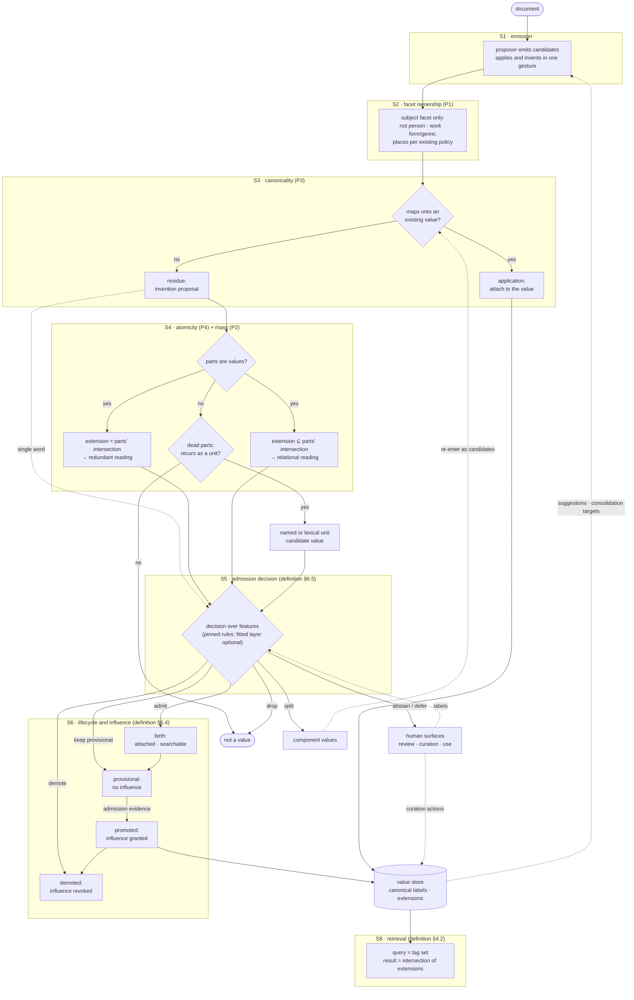
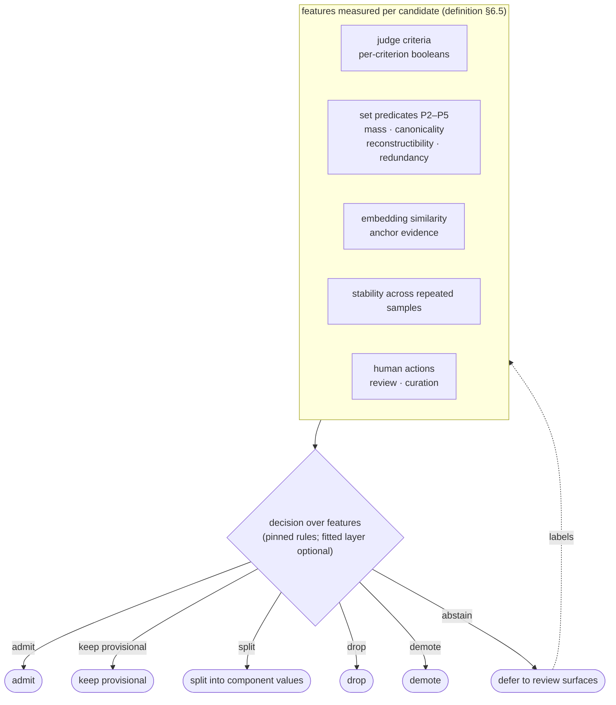

# Tag pipeline — stages and standing duties

Derived from the [definition](definition.md), which is the authority: unqualified §
references in this document point into it, and references to this document are written
`pipeline §x`. It states the end-to-end processing pipeline the definition implies —
emission to retrieval — and the standing duties that keep it honest. Where the definition
records a policy, this document marks its stage-level consequence rather than restating
it. No implementation decisions are made here.

## 1. Pipeline at a glance

The flow's shape encodes three of the definition's central moves:

- **Application and invention are separated structurally** (definition §6.1). S3 resolves
  what the proposer applied onto existing values; only the residue is an invention
  proposal that faces admission.
- **Predicates are evidence, not verdicts** (definition §6.5). S4 produces a composition
  *reading* (redundant · relational · named unit); the disposition belongs to S5, the
  decision over features.
- **Existence and influence are separate** (definition §6.4). Birth makes a label exist on
  documents (attached, searchable); promotion is what grants the store membership,
  suggestion injection, and consolidation targeting the retrieval model depends on.

## 2. Stages

Every stage runs in two modes. In the **observed** mode the store supplies extensions and
counts; in the **prospective** mode — a novel candidate, or a fresh corpus with no
document-tag relationships — there are none, and the stage composes its evidence from the
candidate itself, the values already present, and the model's reading. Prospective
operation is the normal mode at birth; observations confirm or revise its judgments and
never gate them (definition §4.5). Each mechanism also specifies its zero-data ladder.

### S1 — Emission

The proposer (the LLM, definition §6.1) emits candidate strings per document. It applies
the existing vocabulary and invents new names in one gesture; S3 splits those two acts.
The existing vocabulary influences emission through the suggestion surface (S7), which is
also the closed loop's input edge. Human actions can also inject candidates (definition
§6.1); expressions of preference are not read as signals (definition §6.2).

### S2 — Facet ownership (P1)

Precondition, not a set test: only the subject facet passes. Persons, works, and
form/genre belong to their own facets and are excluded; places are ordinary subject
dimensions decided by dimensionality and recurrence (definition §1, §3.4, §5). This stage
is deterministic by design.

### S3 — Canonicality and registration (P3)

One label per retrieval intent. A candidate that denotes the same extension as an existing
value is an application of that value — variant labels (singular/plural, orthographic,
inverted, digit/word, mixed-language) collapse onto the canonical one (definition §3.4,
§3.5, §4.3 P3). The residue is the invention proposal that goes on to S4. What decides is
substitutability of extension, not component-hood.

### S4 — Atomicity and compound resolution (P4, P2)

For a multi-part candidate `c` whose content sequence has a decomposition cover of
segments `p₁…p_k` from the fan (definition §3.6, §4.3 P4; atomicity §3.1):

- **Parts are values, `S(c) ≈ ⋂ S(pᵢ)`** → redundant reading: the compound adds nothing
  to the algebra; it decomposes into its parts.
- **Parts are values, `S(c) ⊊ ⋂ S(pᵢ)`** → relational reading (`ritual violence` is not
  `ritual` ∩ `violence`): a distinct value only if the relation is itself a recurring
  subject of the corpus; otherwise it splits and the relation falls back to free text.
- **Parts are not values (dead parts)** → lexical/named-unit candidate (`internet of
  things`, `black bloc`, `cold war`) admitted whole only if it recurs; otherwise no
  dimension, no value.

The stage outputs the reading plus its evidence (overlaps, part masses); it does not
dispose (definition §6.5). A single-word candidate carries no composition reading and goes
straight to S5.

The mechanism that produces this reading — part derivation, measurements, fallbacks,
dispositions — is specified in [atomicity](atomicity.md).

### S5 — Admission decision

The decision over features — pinned rules as the operating mode, a fitted layer as an
optional refinement — that decides **admit · keep provisional · split · drop · demote**,
and may **abstain** into deferral (definition §6.5). Detailed in §3 below. Its decisions
act on the store, the suggestions, and therefore on future emissions — the loop is closed
and non-stationary.

### S6 — Lifecycle and influence

Birth keeps the born-on-first-emission property: the label is attached and searchable
immediately, but carries no influence until promoted. Promotion requires admission
evidence; demotion revokes influence without deleting existence; a rejected name enters
the blocklist and cannot be reborn (definition §6.4, §7). Detailed in §4 below.

### S7 — Vocabulary services

What promoted values supply to the rest of the system: suggestion injection into the
proposer prompt and consolidation targets for S3 (definition §6.1, §6.4). This is the
influence boundary: provisional values are excluded from all of it.

### S8 — Retrieval

A query is a set of tags and its result is the intersection of their extensions
(definition §4.2). Precision is a property of the query, not of any single tag; a tag is a
coordinate, a query is a point. Intersection search presumes the **completeness
convention** (definition §3.3, §7): a partially applied dimension silently loses
documents, which is why completeness is a first-class duty (D3).

## 3. The decision layer (S5)

Consequences the decision inherits (definition §6.5): a pinned, versioned rule set is the
operating mode and runs with zero labels; a fitted refinement exists only if labels accrue
(the review surfaces are the label source, with binary labels and no training on biased or
mismatched labels), and it is monitored for drift and refitted periodically; features are
measurements of their extractors, so a judge-model or prompt change re-validates the
fitted form. Abstention is what turns uncertainty into deferral instead of a coin flip.

## 4. Lifecycle and influence (S6)

```mermaid
stateDiagram-v2
    [*] --> Provisional : birth — existence only: attached, searchable
    Provisional --> Promoted : promotion — admission evidence; influence granted
    Promoted --> Demoted : demotion — influence revoked
    Demoted --> Promoted : re-admission
    Provisional --> Blocked : reject — name must never return
    Blocked --> [*]
    note right of Demoted : existence retained, influence revoked
```

- **Existence** (a label on documents) survives demotion; the blocklist is the only
  terminal state, and it exists for names that must never return (definition §6.4).
- **Influence** (store membership, suggestion injection, consolidation targeting) is what
  promotion grants and demotion revokes.
- The demotion policy is decided (definition §8): supersession and the scheduled
  rule-reapplication sweep revoke influence only — existence and assignments stay, and
  history remains auditable.

## 5. Standing duties

These are not stages in the flow; they are operations the model requires to keep the
vocabulary healthy, and they attach to the stages they maintain.

| Duty | What it does | Attaches to | Definition ref |
|---|---|---|---|
| **D1 · Canonicalization** | One label per intent as a standing operation, not incident response: variant classes merge or alias by extension evidence | S3 / store (S7) | §6.3 |
| **D2 · Composition review** | Retrospective review over the store: pre-coordinated artifacts (P4), redundancy (P5), and the inverse question for broad values (`device disassembly`: value, or `disassembly` plus an unmarked case?) — producing audit worklists | Store (S7) | §6.3 |
| **D3 · Completeness** | Application recall: every document carries the dimensions applicable to it; a half-applied dimension makes intersections silently under-return | S1 / documents | §6.3, §7 |
| **D4 · Measurement substrate** | The extension algebra — mass, overlap, reconstructibility, part coverage — computed as evidence for S5's features and for D1–D3 | S5 and all duties | §6.5, §4.5 |
| **D5 · Review surfaces** | The gray-band arbiter and the deferral sink; supplies the labels D4 and S5 are calibrated on | S5 / S6 | §6.2, §6.5 |
