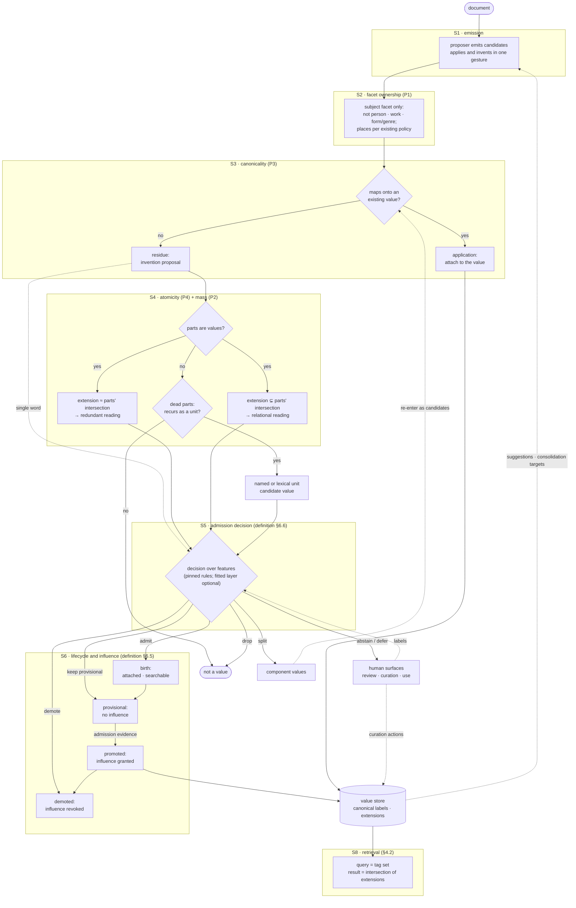
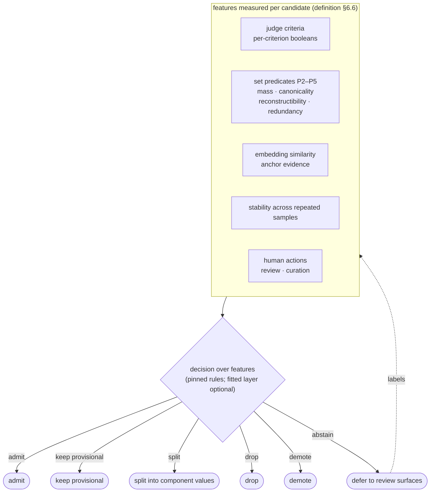

# Tag pipeline model — reference pipeline and adoption analysis

**Status:** Tentative. Derived from the normative tag definition
(`definition-and-faceted-retrieval.md`; unqualified § references point
into it, and colliding section numbers are written as `definition §x`).
It states the end-to-end processing pipeline that the definition implies — emission to
retrieval, with the standing duties that keep it honest — and maps the current
implementation onto it (§6) to make the lacking mechanisms visible.

No implementation decisions are made here, and where the definition records a policy
(§8) the pipeline marks its stage-level consequence rather than restating it. Anchors
in §6 are package-level and reflect what is in the tree as of 2026-09-17.

**How to read:** §1 is the whole flow; §3 and §4 expand the admission decision and the
lifecycle; §6 is the adoption analysis (what exists, what the delta is, what is missing);
§7 is the open-questions register; §8 is the tentative tooling register.

---

## 1. Pipeline at a glance

The flow's shape encodes three of the definition's central moves:

- **Application and invention are separated structurally** (definition §6.2). S3 resolves what the
  proposer applied onto existing values; only the residue is an invention proposal that
  faces admission.
- **Predicates are evidence, not verdicts** (definition §6.6). S4 produces a composition *reading*
  (redundant · relational · named unit); the disposition belongs to S5, the decision
  over features.
- **Existence and influence are separate** (definition §6.5). Birth makes a label exist on
  documents (attached, searchable); promotion is what grants the store membership,
  suggestion injection, and consolidation targeting the retrieval model depends on.

---

## 2. Stages

Every stage runs in two modes. In the **observed** mode the store supplies extensions
and counts; in the **prospective** mode — a novel candidate, or a fresh corpus with no
document-tag relationships — there are none, and the stage composes its evidence from
the candidate itself, the values already present, and the model's reading. Prospective
operation is the normal mode at birth; observations confirm or revise its judgments and
never gate them (§7, item 11). The descriptions below state the semantics; each
mechanism also specifies its zero-data ladder.

### S1 — Emission
The proposer (the LLM, definition §6.2) emits candidate strings per document. It applies the
existing vocabulary and invents new names in one gesture; S3 splits those two acts. The
existing vocabulary influences emission through the suggestion surface (S7), which is
also the closed loop's input edge. Human actions can also inject candidates (definition
§6.2); expressions of preference are not read as signals (§6.3).

### S2 — Facet ownership (P1)
Precondition, not a set test: only the subject facet passes. Persons, works, and
form/genre belong to their own facets and are excluded; places follow the existing
country/continent policy (definition §3.4, §5.3, §7.1). This stage is deterministic by design.

### S3 — Canonicality and registration (P3)
One label per retrieval intent. A candidate that denotes the same extension as an
existing value is an application of that value — variant labels (singular/plural,
orthographic, inverted, digit/word, mixed-language) collapse onto the canonical one
(§3.4, §3.5, §4.3 P3). The residue is the invention proposal that goes on to S4. The
definition supersedes the earlier "is this a component a legitimate class?" test: what
decides is substitutability of extension, not component-hood.

### S4 — Atomicity and compound resolution (P4, P2)
For a multi-part candidate `c` whose content sequence has a decomposition cover of
segments `p₁…p_k` from the fan (§3.6, §4.3 P4; atomicity §3.1):

- **Parts are values, `S(c) ≈ ⋂ S(pᵢ)`** → redundant reading: the compound adds nothing
  to the algebra; it decomposes into its parts.
- **Parts are values, `S(c) ⊊ ⋂ S(pᵢ)`** → relational reading (`ritual violence` is not
  `ritual` ∩ `violence`): a distinct value only if the relation is itself a recurring
  subject of the corpus; otherwise it splits and the relation falls back to free text.
- **Parts are not values (dead parts)** → lexical/named-unit candidate (`internet of
  things`, `black bloc`, `cold war`) admitted whole only if it recurs; otherwise no
  dimension, no value.

The stage outputs the reading plus its evidence (overlaps, part masses); it does not
dispose (definition §6.6). A single-word candidate carries no composition reading and goes straight
to S5.

The mechanism that produces this reading — part derivation, measurements, fallbacks,
dispositions — is specified in `atomicity.md`.

### S5 — Admission decision
The decision over features — pinned rules as the operating mode, a fitted layer as an
optional refinement — that decides **admit · keep
provisional · split · drop · demote**, and may **abstain** into deferral (definition §6.6). Detailed
in §3 below. Its decisions act on the store, the suggestions, and therefore on future
emissions — the loop is closed and non-stationary.

### S6 — Lifecycle and influence
Birth keeps the born-on-first-emission property: the label is attached and searchable
immediately, but carries no influence until promoted. Promotion requires admission
evidence; demotion revokes influence without deleting existence; a rejected name enters
the blocklist and cannot be reborn (definition §6.5, §7.2). Detailed in §4 below.

### S7 — Vocabulary services
What promoted values supply to the rest of the system: suggestion injection into the
proposer prompt and consolidation targets for S3 (definition §6.2, §6.5). This is the
influence boundary: provisional values are excluded from all of it.

### S8 — Retrieval
A query is a set of tags and its result is the intersection of their extensions (§4.2).
Precision is a property of the query, not of any single tag; a tag is a coordinate, a
query is a point. Intersection search presumes the **completeness convention** (definition §3.3,
§7.3): a partially applied dimension silently loses documents, which is why completeness
is a first-class duty (D3).

---

## 3. The decision layer (S5)

Consequences the decision inherits (definition §6.6): a pinned, versioned rule set is
the operating mode and runs with zero labels; a fitted refinement exists only if labels
accrue (the review surfaces are the label source, with binary labels and no training on
biased or mismatched labels), and it is monitored for drift and refitted periodically;
features are measurements of their extractors, so a judge-model or prompt change
re-validates the fitted form. Abstention is what turns uncertainty into deferral instead
of a coin flip.

---

## 4. Lifecycle and influence (S6)

```mermaid
stateDiagram-v2
    [*] --> Provisional : birth — existence only: attached, searchable
    Provisional --> Promoted : promotion — admission evidence; influence granted
    Promoted --> Demoted : demotion — influence revoked
    Demoted --> Promoted : re-admission
    Provisional --> Blocked : reject — name must never return
    Blocked --> [*]
    note right of Demoted : existence retained, influence revoked
```

- **Existence** (a label on documents) survives demotion; the blocklist is the only
  terminal state, and it exists for names that must never return (definition §6.5).
- **Influence** (store membership, suggestion injection, consolidation targeting) is
  what promotion grants and demotion revokes.
- The demotion policy is decided (definition §8.4): supersession and the scheduled
  rule-reapplication sweep revoke influence only — existence and assignments stay, and
  history remains auditable.

---

## 5. Standing duties

These are not stages in the flow; they are operations the model requires to keep the
vocabulary healthy, and they attach to the stages they maintain.

| Duty | What it does | Attaches to | Definition ref |
|---|---|---|---|
| **D1 · Canonicalization** | One label per intent as a standing operation, not incident response: variant classes merge or alias by extension evidence | S3 / store (S7) | §6.4 |
| **D2 · Composition review** | Retrospective review over the store: pre-coordinated artifacts (P4), redundancy (P5), and the inverse question for broad values (`device disassembly`: value, or `disassembly` plus an unmarked case?) — producing audit worklists | Store (S7) | §6.4 |
| **D3 · Completeness** | Application recall: every document carries the dimensions applicable to it; a half-applied dimension makes intersections silently under-return | S1 / documents | §6.4, §7.3 |
| **D4 · Measurement substrate** | The extension algebra — mass, overlap, reconstructibility, part coverage — computed as evidence for S5's features and for D1–D3 | S5 and all duties | §6.6, §4.5 |
| **D5 · Review surfaces** | The gray-band arbiter and the deferral sink; supplies the labels D4 and S5 are calibrated on | S5 / S6 | §6.3, §6.6 |

---

## 6. Adoption analysis — current mechanisms against the pipeline

The mapping below reads the pipeline as a checklist: for each stage and duty, what the
system already has, how far it matches the model, and what the delta is.

**Delta classes:**

- **Aligned** — a mechanism implements the stage's function; at most tuning remains.
- **Re-criteria** — the mechanics exist but enforce a different standard; the change is in
  prompt/criteria/policy text (and the measurement versions those pin).
- **Partial** — mechanisms cover part of the stage's function; the rest is a capability
  that does not exist.
- **Absent** — no mechanism.
- **Conflict** — a locked existing decision contradicts the model and needs explicit
  reconciliation (see the conflicts list below).

### 6.1 Summary

| Stage / duty | Existing mechanism | Status | Delta |
|---|---|---|---|
| **S1 Emission** | Typed generation contract, subject-matter rule, choose-or-justify, two negatives, dimension language and compound decomposition (`analyzer/prompt.go`); suggestions injected from the store | Partial | Coverage wording pending; the dictionary-standard selection language is retired |
| **S2 Facet ownership (P1)** | `SeparateFacets` category gate (persons, form/genre) + the deterministic time-designation gate (`internal/enrichment/enricher.go`) | Aligned | Places and works are ordinary subject candidates; untyped emissions degrade to string heuristics (accepted) |
| **S3 Canonicality (P3)** | Consolidation policy gates/bands (`policy`), LLM adjudicator + verdict cache, alias disposition, reconciler | Partial | Similarity band misses the variant classes; no extension-equality detector |
| **S4 Atomicity (P4)** | General compound decomposition at emission over the in-order segment fan, disposed by the coarsest cover (`Adjudicator.DecomposeTags`, `analyzer` split gate — one `tag_composition_event` verdict row per judged compound) + the stored-compound scan (`reconcile/compounds.go`, judged through `Adjudicator.JudgeCompounds`), both disposing through `tags.DecideComposition` over the parts, compound, and substrate reconstructibility features | Landed | The band cuts are provisional, calibration-owned (§7 item 9) |
| **S5 Admission decision** | Rubric judge + verdict cache; pinned decision over the judge answers plus deterministic signals (`tags.DecideAdmission`); promotion = admitted + the 10-live-document floor (`tags.DecidePromotion`, `tags.RecurrenceFloor`) | Landed (pinned decision) · Absent (fitting) | No set predicates among the admission features (the P4 extension test feeds the composition decision); the optional fitted form (calibration, distilled filter) is unshipped — the decision runs pinned and label-free; the repeat-disagreement rule is unshipped |
| **S6 Lifecycle** | `promoted_at` quarantine/promotion and `demoted_at`/`demoted_reason` demotion, the seeded exemption (`tag.seeded`), store trust boundary, sweep, blocklist | Aligned | — |
| **S7 Vocabulary services** | Promoted-only store (`BuildTagCache`), suggestions, consolidation targets, promoted-names fallback | Aligned | — |
| **S8 Retrieval** | Multi-tag AND filter (`internal/database/structured_search.go`, `tagsAnd`) and the coverage audit that measures dimension coverage (`GET /api/v1/tags/audit/flags`, the tags page's Coverage tab) | Aligned | — |
| **D1 Canonicalization** | Adjudicator and reconciler — the reconciler's twin arm consumes the measurement `≈` worklists and the confirmed flips alias | Landed as a standing duty | Gray bands stay evidence-only; the containment readings surface read-only on the Overlap tab |
| **D2 Composition review** | Reconciler's stored-compound scan over every stored compound, disposed through the composition decision over the substrate reconstructibility reading (live mass and the parts' intersection) | Landed as a standing duty | The band cuts are provisional, calibration-owned |
| **D3 Completeness** | The scheduled coverage audit (`kushim tagaudit`, `internal/tags/admission/audit.go`) and its review surface (`GET /api/v1/tags/audit/flags`, `apply`, `dismiss`, `create-value`; the tags page's Coverage tab) | Landed | The emission-side contract wording ("every applicable dimension") is pending (S1) |
| **D4 Measurement substrate** | The measurement run (`tag_measurement`, `RuleSetVersion`) computing the extension operators — live mass, pair overlap (`jaccard`, `containment_a/b`), equality, containment, reconstructibility (excess and deficit against the parts' intersection), part coverage, complement, and coverage — read live by the decision (`Store.ReconstructibilityBatch`) and per run for the worklists (`Store.LatestWorklists`, `Store.SiblingWorklist`); embedding similarities and pair verdict stats supply the other features | Landed | — |
| **D5 Review surfaces** | Provisional review queue, blocklist, reconciliation report, coverage audit flags, and the overlap review readings | Partial | Labels accrue from review verdicts; usage is not a signal (definition §6.3) |

### 6.2 Stage notes

**S1–S2 — emission and facet gate.** S2 is the model's P1 exactly: the typed category gate
over persons and form/genre, plus the deterministic time-designation gate (a year, decade,
month, month+year, or unseeded ordinal period unit is a time designation, dropped with its
own reason; a seeded period is a store application), with the string
heuristics as the untyped fallback. S1 carries the first re-criteria: the prompt asks for
the document's broad subjects (the topics a reader would use to find other documents like
this one), one subject per tag, and teaches compound decomposition — when the parts of a
phrase each name a subject that would work as a tag on its own, the parts are emitted
instead of the phrase (`X of Y`, adjective + head, device + operation, both-parts-exist
compounds), while fixed names and set phrases stay whole. The dictionary-standard
selection language is retired; the two canonical rejections that remain are form and
unique argument, and places and works are ordinary subject candidates.
Coverage wording (every applicable dimension) is still pending. The
suggestions surface is the vocabulary's only influence on emission.

**S3 — canonicality.** The mechanisms are substantial: the birth-time identity pipeline
(M1–M4 and M8 with the same-intent gate, `tag_identity_event`, `tag_alias`), the alias
disposition the sweep applies to confirmed flips, and scheduled reconciliation. What the
model adds is the *signal*: one label per intent decided by extension equality (P3)
rather than embedding similarity. The snapshot shows why the difference matters — the
singular/plural, orthographic, inverted, digit/word, and mixed-language variant classes
sit outside the similarity band; orthographic and inverted pairs resolve mechanically at
birth, the rest reach the same-intent gate; merges are incident-driven;
and human rejection deletes names through the blocklist (terminal) where the model's
disposition for a same-intent label is alias/merge.

**S4 — atomicity.** At emission, every compound candidate (2–3 words, Latin script,
content parts) whose key is not already in the store goes to the split gate,
except a seeded period the store holds (an ordinal plus century/decade/
millennium, `tags.IsPeriodClass` over the house form), which is a store
application that stays whole and never reaches judgment (an unseeded time
designation is dropped before the gate). Store-keyed compounds are applications and skip judgment only once a
current-version verdict decides them; a missing or degraded verdict re-enters
judgment, and a decided keep applies its judged-dimensional parts alongside from
the cache):
with the adjudicator enabled the decision runs two context-free judged passes — a
parts pass over each fold-resolved fan segment (a content word or a contiguous bigram;
fold resolution anchors on the
promoted store view; a multi-base part folds only onto its primary-sense base and only
while that base is live, the residue routed to the phrase-context fold judge, and a part
the attested table does not cover folds through a
pinned variant class) and a compound pass reading the
phrase as a named unit, a composition, or a phrase with no retrievable dimension —
folded into `tags.DecideComposition`, which disposes by the coarsest in-order cover over
the fan; without one only conjunction joints (`and`,
`or`, `vs`, `versus` — `textnorm.SplitJointTag`) split mechanically while other
compounds pass whole. The reconciler re-uses the same decision for stored
tags — `Adjudicator.JudgeCompounds` judges every stored compound, not only
conjunctions, so a compound disposes identically at emission and in the sweep —
and its twin arm canonicalizes the near-identical labels the measurement
worklists propose. P4 is wider than
conjunctions and is a set test, not a surface one. The decision reads the
substrate: where the store holds the compound, its live extension against the
judged cover's parts decides the reconstructibility signal — the firm and gray
bands reconstruct it, and the far band marks the whole as not their product, so a
judged composition keeps whole as a relational keep instead of splitting — while
a compound born in a document has no extension yet and disposes on the
prospective ladder (the promoted-parts proxy, with the parts judged for
dimension). “No blanket mechanical splitting” remains the rule for the no-judge
path.

**S5 — admission.** The mechanics are the rubric judge (`subject_matter`,
`not_person`, `atomic`, `not_form_genre`, plus the optional `defer`
abstention), the parts pass that owns the `dimension` verdict the gate reads
from its shared cache and stamps onto the row, the verdict cache, and the pinned
decision over the features:
`tags.DecideAdmission` defers on the judge's abstention, rejects on two or
more failing signals, defers on exactly one (the gray band), and admits when
nothing fails; the emission's deterministic signals (a detail annotated
`other`, a best store similarity below the no-anchor floor) join the judge
answers. The definition's §2.4/§7.1 flipped the expected reject class:
pre-coordinated compounds and document-specific coinages become rejects,
corpus-valid values (repair-corpus terms) become admissible, and `defer`
gives the judge an explicit abstention. `tags.DecidePromotion` keeps the
definition's P2 recurrence floor — an admitted name with ≥ 10 live documents —
so mass is a floor, not a feature of the decision. The remaining gap is the
set predicates: admission decides over its judge answers, the owned `dimension`
verdict, and the emission's deterministic signals, while the P4 extension test's
reach is the composition decision. The fitted refinement is unshipped: the
designed repeat-disagreement rule and the label-gated stages (conformal
calibration; distilled filter) anticipate the optional fitted form (definition
§8.10, staged). Labels accrue under the definition's criteria, satisfying the
label-hygiene precondition of definition §6.6.

**S6 — lifecycle.** Implemented as the model wants: a label exists and is searchable
from birth; provisional values are excluded from every injection point (store built
from promoted names only, promoted-names fallback, identity and gate subjects);
promotion is inline plus swept; influence is revocable — a promoted value loses its
standing and store membership, keeping its row, its assignments, and a
`demoted_at`/`demoted_reason` record, when its live mass falls below the floor, when a
fresh re-judge under the current criteria rejects or defers it, when the sweep decides
a stored compound names no dimension, or by an operator action; seeded values are
exempt from every demotion path and from the dead-tag sweep; judge failure degrades to
provisional; the blocklist prevents rebirth.

**S7–S8.** S7 matches the model's influence boundary exactly. S8 is the intersection
algebra already `tagsAnd` in the structured search, and the completeness
precondition it needs is measured: the scheduled coverage audit (`kushim
tagaudit`) samples the sweep register, fills confirmed gaps, and records a
coverage class per reading, while the emission contract's coverage wording is
still pending.

**Duties.** D1 runs as a standing duty — the twin arm consumes the measurement
`≈` worklists and aliases the resolved pairs — while the canonicality signal
still comes from judged verdicts and the pinned variant classes rather than the
P3 extension-equality detector. D2 runs: the stored-compound scan disposes every
stored compound through the composition decision over the substrate
reconstructibility reading. D3 runs as the coverage audit plus its review
surface, with the emission contract's coverage wording pending. D4 is the
measured substrate: the extension operators — mass, overlap with both
containment ratios, reconstructibility's excess and deficit, part coverage,
complement, and coverage — are computed per value and per pair, persisted per
run, and read live by the decision, with embedding similarity and pair verdict
stats remaining the neighbours' evidence. D5 is partial: the provisional queue,
the coverage flags, and the overlap readings yield review labels, and usage is
not read as a signal (definition §6.3).

### 6.3 Remaining gaps, ranked

Ordered by what unlocks the rest, not by effort:

1. **S1 · coverage wording** — the contract's instruction that every applicable
   dimension is emitted. It is the producer-side half of completeness; the audit half
   runs (`completeness.md`).
2. **Cut calibration** — the worklist and band cuts are provisional v1 constants; the
   thresholds are calibration-owned (definition §8.9), and a cut change is a
   measurement-version event (re-derivation, plus a `TagSplitVersion` bump when the
   reconstructibility cuts move).
3. **The fitted refinement (S5, D5)** — optional and label-gated: a calibrated band or a
   distilled filter where labels accrue; the pinned rule sets run with zero labels until
   then (definition §8.10).
4. **P3 canonicality from extensions (D1)** — the same-intent path resolves by judged
   verdicts and the pinned deterministic variant classes, with the `≈` worklist ranking
   candidates; the store-side extension-equality detector is not the canonicality signal
   (definition §4.3 P3; §6.4 item 4).

### 6.4 Conflicts needing explicit reconciliation

1. **Judge standard vs dimension standard** — the rubric is the dictionary standard;
   under the definition its expected verdicts change. Bumping the judge's measurement
   version and re-judging is the mechanical form; labels collected before the change are
   biased for training the layer (definition §6.6).
2. **Conjunction-only splitting vs P4 — resolved (2026-09-20): the restriction is
   retired.** General decomposition is live at emission (adjudicated; the conjunction
   grammar split remains the no-judge fallback and the stored-tag worklist), and the
   wider fan disposes retrospectively through the stored-compound scan.
3. **Recurrence as gate vs weak prior — resolved (2026-09-20): the gate is retired.**
   The staged decision (§6.6) reads mass and the judge verdict as features; recurrence
   stops being read as quality evidence.
4. **Embedding-driven identity vs extension equality** — consolidation's machinery is
   compatible, but the canonicality signal must come from extensions (P3), not
   similarity; adjudication remains for the gray band.
5. **Deletion vs canonicalization — resolved (2026-09-19): alias, never deletion.**
   Same-intent labels alias to the canonical one
   (`canonical-form-and-identity.md`); the review surface's reject path remains
   for names that must never return.
6. **One-way promotion vs demotion — resolved: demotion is live.** A promoted value
   loses its standing and store membership — keeping its existence and assignments and
   recording why — on mass decay below the floor, on a fresh reject/defer under the
   current criteria, on a decided no-dimension drop, or by an operator action; seeded
   values are exempt (definition §8.4).
7. **Quarantine × canonicalization** — provisional values are not consolidation targets
   by design, so variant emissions birth sibling provisionals (accepted churn); under D1
   this interaction needs revisiting.
8. **Corpus relativity — resolved (2026-09-19): global.** Mass, audits, and completeness
   use store-wide counts; grouping by document metadata is analysis-time only (definition
   §8.8).
9. **Place policy** — there is no place carve-out: the country/continent whitelist is not a
   validation gate, places are ordinary subject dimensions judged by dimensionality and
   recurrence, and the seeded country/continent values serve as influence only. No facet
   gate rejects a tag for being a sub-national place.
10. **Measurement versioning** — a judge or prompt change is a measurement change; the
    design already pins `policy_version`/`TagQualityVersion`, so re-criteria implies
    re-judging and label-pool hygiene.

### 6.5 Component roles — how the new machinery and the incumbents fit

The sections above compare the pipeline stage by stage; this one defines the
relationship at the component level, so a child plan can see what each incumbent piece
becomes and where the seams are. Nothing is dismantled: a mechanism whose *decision*
authority moves to features and rules keeps its mechanics and becomes a supplier.

| Incumbent component | Role under the model | What crosses the seam |
|---|---|---|
| Typed contract and prompt (`analyzer`) | the emission carrier — typed shape and negatives stay; dimension language and decomposition are added; coverage wording is pending | consumes the inventory and the canonical-form instruction; produces emissions and proposed names |
| Facet gates (`SeparateFacets`) | narrowed policy surface (P1): persons and form/genre drop; the time-designation gate drops unseeded time designations | facet drops; places and works pass as ordinary candidates |
| Seeded vocabulary (`seed-tags.sql`, `seed-tag-aliases.sql`) | the starting inventory: re-derived from the specs (broad, atomic, house form) and extended, with the place list and the centuries materialized as values and the recognized alternate spellings as alias rows; inserted with influence | consumed by suggestions and as anchors; never a validation list |
| Consolidation bands (`policy`) | candidate generation only: identity and gate subjects; similarity ranks, never decides | consumes emissions; produces gate subjects |
| Adjudicator and pair-verdict table | the same-intent gate reader; verdicts become evidence, never identity authority | consumes gate subjects; produces verdicts (features, labels) |
| Alias disposition | the canonicalization action: a same-intent loser aliases onto the canonical and is never deleted | consumes canonicalization worklists; produces alias rows |
| Reconciler (`reconcile`) | the retrospective action executor — decomposition, anchor creation, alias materialization, report-only first | consumes composition-review and canonicalization worklists; produces store changes and reports |
| Rubric judge, quality verdict cache, admission decision | feature providers and the pinned decision over features — the judge's conjunction is no longer the verdict, and the decision carries an abstention path | consumes candidates and documents; produces per-criterion booleans, deterministic signals, cached features, and the disposition |
| Quarantine and promotion gate | lifecycle mechanics (existence versus influence); promotion becomes one input to the staged decision | consumes birth and document events; produces provisional/promoted state |
| Review queue | the deferral sink and the label source | consumes deferrals and flags; produces labels |
| Blocklist | terminal rejects only — never same-intent twins | names that must never return |
| Event and verdict tables | the measurement and label substrate, version-pinned | versioned events; consumers read |

The new components wrap rather than replace these: the **extension algebra** reads the
store and produces evidence; **composition review** turns it into worklists acted
through the reconciler; the **canonicalization detector** turns `≈` pairs into alias
actions; **completeness** adds the contract requirement and its separate
audit; the **staged decision** is the pinned rule set over the feature vector, with
abstention into review; **demotion** revokes influence through the same lifecycle
mechanics.

Three seams carry the relationship:

1. **Evidence** — incumbent verdicts, counts, and similarities are candidate evidence;
   the algebra and the feature vector are the only place where they become decision
   inputs, and no component decides alone.
2. **Action** — the new machinery produces worklists; the incumbents execute them
   through the review surfaces; nothing acts outside them automatically.
3. **Governance** — one measurement story (policy version, judge version, rule-set
   version); a bump re-judges and refreshes, and labels carry their version.

### 6.6 Retirements — redundant and contradictory incumbent parts

The role map defines what survives as a supplier; this section names what does not.
"Retire" here means the rule, action, or criteria text is removed when its replacing
stage lands — nothing is deleted before the replacement exists, and mechanics that
compute a retired signal may live on as feature providers.

| Incumbent rule, action, or text | Why it cannot stand | Replaced by |
|---|---|---|
| Promotion gate as a conjunctive rule (cached pass AND the 10-document floor) | mass still enters as a floor rather than a feature of the decision | the staged decision (§3) |
| `max_tags` as a quality bound | a count cap contradicts coverage: the contract must deliver every applicable dimension | the completeness contract |
| "Never split non-conjunctions" at runtime | contradicts P4's fan; the prospective/retrospective split was the interim | general decomposition at emission |
| Reject-as-delete for provisional twins (name into the blocklist) | same-intent labels alias, never delete | the alias disposition; terminal rejects keep the blocklist |
| Hard-merge deletion of a same-intent pair | the loser's name must remain resolvable | the alias disposition (a `same` flip aliases, a `keep` flip withdraws the alias) |
| Legacy prompt and judge criteria (document relevance, dictionary standardness) | the definition re-derives both | the re-criteria, landed in place under the same version; the store reset retires the cached rows |
| Duplicated measurement helpers (`CountLiveTagDocumentsByTagIDs`, `TagPairEvidenceStats`) | subsumed by the extension algebra | the measurement substrate |

Sequencing rules for the retirements: the guards and similarity auto-replace are
retired — identity is gate-based at birth; the emission cap is retired and the
completeness contract adds the coverage requirement; the runtime splitting restriction
is retired with the general decomposition; the blocklist's
existing entries (258 names) get a reconciliation pass — same-intent twins become
aliases, terminal rejects stay; and the retired criteria text changed in place under
the same quality version, riding the store reset that retires the cached rows.

Explicitly retained: facet gates (P1, with the place bug fixed), exact-key identity,
quarantine and promotion mechanics, the review surfaces (the provisional queue and the
blocklist), the reconciler and sweeps as executors, suggestion injection, and the
versioned verdict caches.

---

## 7. Open points the pipeline deliberately leaves visible

These are the policy questions the definition resolves (§8) that change the pipeline's
shape, plus the prospective-mode requirement the formalization raises. The adoption
analysis surfaces where they bite; every item is now decided or standing, marked in
place for the record.

1. **Relational compounds — decided (2026-09-20).** An ordinary candidate: the
   definition's five properties and P4 decide; no separate rule (definition §8.1; S4).
2. **Named units — decided (2026-09-20).** Admitted whole above the recurrence
   threshold (calibration's number), tracked as candidates while accumulating, their
   parts applied alongside; utility, not parts-failure, is the boundary (definition
   §8.2; S4).
3. **Canonical-form policy — decided (2026-09-19); specified in
   `canonical-form-and-identity.md`.** Birth-time shape and identity rules with
   the alias disposition; the kindred-form direction criterion is rejected (no axis
   model; §8.7 decided).
4. **Demotion policy — decided (2026-09-20).** Supersession and the scheduled
   rule-reapplication sweep; influence-only revocation, assignments and history intact
   (definition §8.4; S6).
5. **Completeness mechanics — decided (2026-09-20); specified in
   `completeness.md`.** Contract as primary producer plus a separate audit; the
   acceptance test and coverage classes are in the spec.
6. **Preference channel — rejected (2026-09-20).** Usage is not a signal; review
   surfaces serve error correction and gray-zone arbitration (definition §8.6; D5).
7. **Axis grouping — decided (2026-09-20): none.** The vocabulary stays emergent; no
   stored or derived axis structure, and no audit depends on one. Missing anchors are
   the mechanical residue of decomposition and completeness, or a user action; any
   grouping happens outside the system (definition §8.7; D2).
8. **Corpus relativity — decided (2026-09-19): global.** Extensions, mass, and audits are
   store-wide; analysis-time grouping by document metadata replaces scoping, which is not
   built (definition §8.8; D4).
9. **Thresholds — decided (2026-09-20): calibration-owned.** `m`, the set-equality
   threshold for `≈`, and the containment threshold for redundancy are fitted on labels;
   nothing conceptual remains open (definition §8.9; S4/S5).
10. **Decision layer and label supply — decided (2026-09-20): staged.** Pinned rules are
    the operating mode at zero labels; fitting is an optional, label-gated refinement;
    abstention, drift, and re-validation attach to that refinement (definition §8.10;
    S5).
11. **Prospective-first operation — standing requirement.** Every mechanism must run
    with zero observations: a novel candidate has no extension and a fresh corpus has no
    relationships, yet tagging must proceed. The predicates are defined over observed
    extensions (§4.5); each mechanism therefore specifies its zero-data ladder (parts
    and shape, values already present, the model's reading), with observations confirming
    or revising the judgment and never gating it. Mechanisms that read the store —
    consolidation, promotion, verdict caches — are refinements of this mode, not its
    precondition.

---

## 8. Tooling landscape — tentative integrations

**Status:** exploratory register, collected 2026-09-17. Candidates for the gaps in §6.3,
to be kept, refined, or dropped later; nothing here is a decision. Facts (pipeline
support, parameter counts, licenses) come from primary sources — Hugot's README, Hugging
Face model metadata, project READMEs — not from benchmarks or local trials.

The survey's main finding reframes integration cost: **the dependency already in `go.mod`
is the integration channel.** Hugot v0.7.4 implements, beyond feature extraction, the
`crossEncoder`, `zeroShotClassification`, `textClassification`, `tokenClassification`,
`tabular`, and `textGeneration` (ORT GenAI) pipelines — so most candidates below are an
ONNX model plus a pipeline, hosted with the existing `kushim` daemon pattern; no new
runtime, and no Python in production.

### 8.1 In-process models (existing Hugot dependency)

| Tentative use | Model | Weight and notes |
|---|---|---|
| Synonym-vs-related discrimination in the consolidation band (S3, D1) | [`cross-encoder/mmarco-mMiniLMv2-L12-H384-v1`](https://huggingface.co/cross-encoder/mmarco-mMiniLMv2-L12-H384-v1) | 118M params, multilingual (es, pt, fr, de, it, ar, zh, ja, ru, …), ONNX and int8 variants in-repo; the reranking answer to the 0.80–0.95 cosine band |
| Same job at minimum weight, English only | [`cross-encoder/ms-marco-MiniLM-L6-v2`](https://huggingface.co/cross-encoder/ms-marco-MiniLM-L6-v2) | 23M params (~90 MB fp32; int8 variants available) |
| Entailment / “is this document about X”: S5 features and D3 completeness | [`cross-encoder/nli-MiniLM2-L6-H768`](https://huggingface.co/cross-encoder/nli-MiniLM2-L6-H768) (English) or [`MoritzLaurer/mDeBERTa-v3-base-xnli-multilingual-nli-2mil7`](https://huggingface.co/MoritzLaurer/mDeBERTa-v3-base-xnli-multilingual-nli-2mil7) (26 languages) | 82M / 279M (fp16), ONNX and quantized files available; runs as `zeroShotClassification` |
| Admission decision (S5) — optional fitted refinement | sklearn tree/forest exported to ONNX, run via the `tabular` pipeline | Hugot's README lists decision trees and random forests; not verified against its tests in this survey; keeps the fitted form auditable and in-process |
| Local generative judge, provider-free (S5) | any ONNX LLM via `textGeneration` (ORT GenAI) | 0.5–2B parameters and up — heavier; only if API-free judging becomes a requirement |

### 8.2 Pure-Go micro-libraries

- **[lingua-go](https://github.com/pemistahl/lingua-go)** — language detection, 75
  languages, works on single words and phrases, offline, no dictionaries (Apache-2.0).
  Tentative use: mixed-language emissions (`marxism anarquismo`) in S3/D1, and routing
  for stemmers.
- **[blevesearch/snowballstem](https://github.com/blevesearch/snowballstem)** — the
  Snowball stemmers generated for Go. Tentative use: generating canonicality candidates
  (plural folding, `-ise`/`-ize`) as evidence for P3, never as the decision.
- **[aaaton/golem](https://github.com/aaaton/golem)** — dictionary-based lemmatizer,
  pure Go (MIT; per-language dictionaries under ODbL; en, de, es, fr, it, sv). Tentative
  use: lemma signatures as evidence for the canonical-form rules
  (`canonical-form-and-identity.md`), never as the verdict.
- **[xrash/smetrics](https://github.com/xrash/smetrics)** — Levenshtein, Jaro,
  Jaro-Winkler, Soundex, Hamming. Tentative use: cheap orthographic candidate triggers
  for D1.

### 8.3 Offline tooling (fitting, calibration, analysis — not runtime)

- **[crepes](https://github.com/henrikbostrom/crepes)** (BSD-3, sklearn-compatible) —
  conformal prediction. Tentative use: calibrating the fitted refinement's abstention
  thresholds (S5) and producing the deferral boundary that separates admit, defer, and
  drop.
- **[SetFit](https://github.com/huggingface/setfit)** (Apache-2.0) — few-shot
  classification over sentence transformers; 8 labels per class competitive with full
  training; multilingual bodies. Tentative use: label-efficient training for the
  distilled filter / fitted refinement once the review queue yields labels; the ONNX
  export path needs checking.
- **[model2vec](https://github.com/MinishLab/model2vec)** (MIT) — static embeddings
  distilled from a sentence transformer in ~30 s CPU (smallest published variants around
  tens of MB); `potion-multilingual-128M` is distilled from bge-m3. Tentative use: cheap
  tag-name nearest-neighbor candidate generation without loading the matcher;
  `StaticModelForClassification` as a tiny few-shot classifier.
- **Keyphrase extraction** (YAKE, KeyBERT, pke) and the in-house TextRank — tentative
  use: proposing the dimensions applicable to a document for D3 audits.
- **DuckDB** — tentative use: the retrospective D4 measurement pass over a Postgres
  export.
- **ONNX export tooling** (Hugging Face Optimum) — tentative use: preparing any of the
  checkpoints above for the Hugot pipelines.

### 8.4 Plausible but weigh carefully

- `BAAI/bge-reranker-v2-m3` — 568M params (~2.3 GB fp32), multilingual; the same size
  class as the matcher, so no weight win over the mmarco MiniLM.
- `jinaai/jina-reranker-v2-base-multilingual` — CC-BY-NC-4.0 license.
- Qwen3-Reranker family — LLM-based rerankers (0.6B and up, generative pipeline),
  larger and a different integration.
- A second general embedder, a vector index at this vocabulary size, or
  WordNet/DBpedia-style lexical resources — the last conflicts with the
  no-curated-lists principle.

### 8.5 Fit to the ranked gaps

| Gap (§6.3) | Candidate tooling |
|---|---|
| D4 · extension algebra | DuckDB for the retrospective pass; model2vec for cheap similarity where full extensions are not needed |
| D3 · completeness | NLI entailment over candidate dimensions; keyphrase extraction; in-house TextRank |
| Re-criteria of S1/S5 | no tooling needed — prompt and criteria text |
| D1 · canonicalization | multilingual cross-encoder; lingua-go; snowballstem; smetrics |
| D2 · composition review | no tooling beyond D4's measurements |
| S6 · demotion | no tooling needed |
| S5 · decision layer | NLI/zero-shot features and the abstention path for the pinned-rule mode; tabular ONNX layer, crepes calibration, SetFit only for the optional fitted refinement |

**Caveats.** Parameter counts come from Hugging Face metadata, so download sizes are
smaller (and quantized variants exist where noted). Pipeline support is from Hugot's
README; the `tabular` entry in particular was not verified against its tests, and no
model above was benchmarked or integrated locally in this pass.
